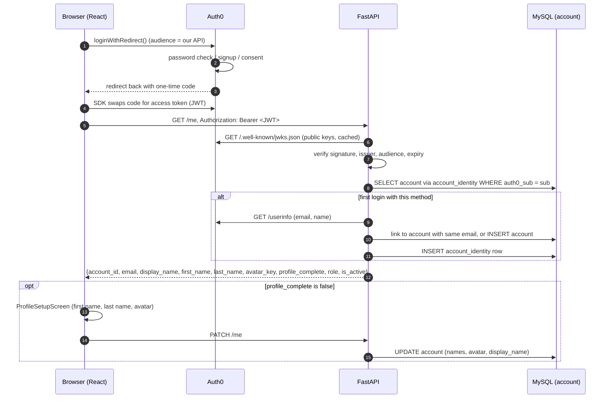
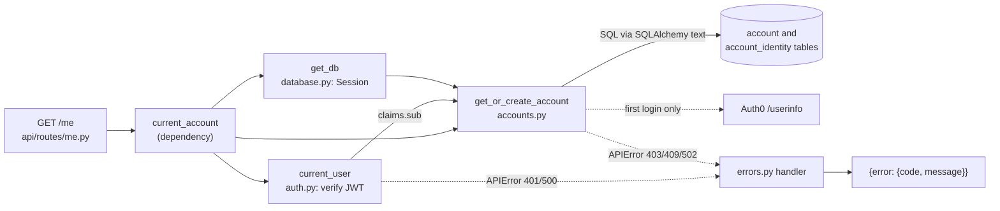
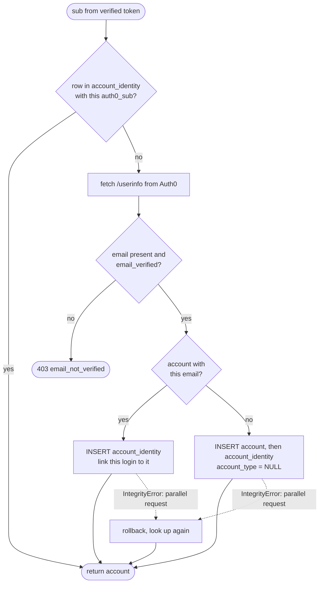
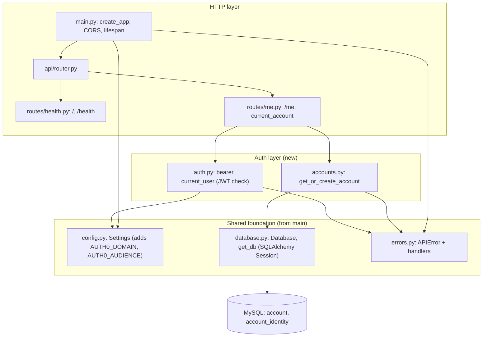

# Authentication and accounts

How login works, how the backend trusts a request, and how a person becomes a row in the `account` table. Auth0 handles email/password sign-in; the group dropped Google sign-in. We never store or see a password.

- **Frontend:** Auth0 login, logout and session restore (`@auth0/auth0-react`).
- **Backend:** verifies the Auth0 access token (JWT), then finds or creates the user's `account` row in MySQL.

## 1. End-to-end login



The backend shares no secret with Auth0. It trusts a token only because the signature verifies against Auth0's published public keys.

## 2. Backend request flow through the layers



`current_account` is the single dependency a route uses to get the logged-in user's account. It runs `current_user` first, so a bad or missing token is rejected before the database is touched.

## 3. `get_or_create_account` decisions



Each Auth0 login has its own `sub` (email/password gives `auth0|...`; accounts made before Google sign-in was dropped may also have a `google-oauth2|...` one). Each `sub` is a row in `account_identity` (migration `0004`) pointing at one `account`, so a second login method with the same verified email is linked to the existing account instead of failing. Linking requires `email_verified`, otherwise someone could sign up with another person's address and be attached to their account.

## 4. Where auth sits in the backend layers



Auth added two modules (`auth.py`, `accounts.py`), one route module (`routes/me.py`), two settings (`auth0_domain`, `auth0_audience`) and the `pyjwt[crypto]` dependency. It reuses `Settings`, `get_db` and `APIError` and does not replace them.

## 5. Files

### Backend (`backend/app/`)
| File | Role |
|---|---|
| `config.py` | `Settings` read from env/`.env`. Auth fields: `auth0_domain`, `auth0_audience`. |
| `database.py` | `Database` engine and `get_db`, one SQLAlchemy `Session` per request. |
| `errors.py` | `APIError` and handlers; every error is `{"error": {"code", "message"}}`. |
| `auth.py` | `current_user`: reads the bearer token, fetches Auth0's public keys (lazily, cached), verifies RS256 signature, issuer and audience, returns the claims. |
| `accounts.py` | `get_or_create_account(db, domain, sub, token)`: the logic in section 3. |
| `api/routes/me.py` | `current_account` dependency, `GET /me` and `PATCH /me` (save the profile). |
| `avatars.py` | The preset avatar allowlist (`figure.color` keys). `frontend/src/avatars/catalog.js` holds the same ids. |
| `api/router.py` | Registers the health and me routers. |

### Frontend (`frontend/src/`)
| File | Role |
|---|---|
| `main.jsx` | Wraps the app in `Auth0Provider` (domain, client id, redirect URI, audience). |
| `App.jsx` | Reads login state from `useAuth0()`, session restore, logout, shows login page or lobby. A "no session" error from the silent check stays hidden; after a Sign in / Create account click it shows a message. |
| `components/LandingPage.jsx` | Sign in and Create account buttons in the header, hero and closing section. Each goes straight to Auth0 (Create account adds `screen_hint: 'signup'`), pinned to the email/password connection. Google is also disabled for the app in Auth0, so email/password is the only connection and there is no Google button. |
| `components/AccountGate.jsx` | Calls `/me` once logged in (creating the account on first login), then shows the verify-email, deactivated or profile setup screen if needed before the lobby. |
| `components/VerifyEmailConfirmPage.jsx`, `verifyEmailLink.js` | The public `/verify-email` page the verification email links to, and the check on the Auth0 link it carries (section 10). |
| `components/ProfileSetupScreen.jsx`, `components/ProfileForm.jsx` | The one-time "Make it yours" screen: first name, last name and a preset avatar, saved with `PATCH /me`. The same form backs Edit profile (`/app/profile`). |
| `avatars/` | `Avatar` (preset tile or initials), `AvatarPicker`, and the figure/color catalog. |
| `api.js` | `apiFetch(path, getToken, options)`: attaches the bearer token and throws `error.message` from the error body. Also `PASSWORD_CONNECTION` (`'Username-Password-Authentication'`), which every interactive `loginWithRedirect` passes as `connection`. |

## 6. Configuration

Never commit real values. The `.env` files are gitignored; each folder has a `.env.example`.

**Frontend (`frontend/.env`)**
| Variable | Meaning |
|---|---|
| `VITE_AUTH0_DOMAIN` | Auth0 tenant domain |
| `VITE_AUTH0_CLIENT_ID` | Client ID of the Single Page Application |
| `VITE_AUTH0_AUDIENCE` | Identifier of our Auth0 API (e.g. `https://quiz-platform-api`) |
| `VITE_API_BASE_URL` | Backend URL (`http://127.0.0.1:8001` in the example) |

**Backend (`backend/.env`)**
| Variable | Meaning |
|---|---|
| `AUTH0_DOMAIN` | Same tenant domain, no `https://` |
| `AUTH0_AUDIENCE` | Must equal `VITE_AUTH0_AUDIENCE` |
| `CORS_ORIGINS` | Allowed browser origins (default `http://localhost:5173`) |
| `DB_HOST`, `DB_PORT`, `DB_DATABASE`, `DB_USERNAME`, `DB_PASSWORD` | MySQL connection (or `DATABASE_URL`) |

Auth0 dashboard settings for the SPA: `http://localhost:5173` must be allowed as callback, logout and web origin URLs.

## 7. Running locally

```bash
# 1. Database (Docker, no school network needed)
docker run -d --name quizdb-dev -e MYSQL_ROOT_PASSWORD=devpass \
  -e MYSQL_DATABASE=quizdb -p 3307:3306 mysql:8.0
for f in ulugbek-err/migrations/*.up.sql; do
  docker exec -i quizdb-dev mysql -uroot -pdevpass quizdb < "$f" || break
done
# backend/.env: DB_HOST=127.0.0.1 DB_PORT=3307 DB_DATABASE=quizdb DB_USERNAME=root DB_PASSWORD=devpass

# 2. Backend on 8001 (the port the frontend's .env.example expects)
cd backend && source .venv/bin/activate
pip install -r requirements.txt
uvicorn app.main:app --reload --port 8001

# 3. Frontend on 5173
cd frontend && npm install && npm run dev
```

Check: `curl localhost:8001/health` returns database `ok`, and `curl localhost:8001/me` returns 401 `missing_token`. Logging in at http://localhost:5173 creates your row; inspect it with
`docker exec quizdb-dev mysql -uroot -pdevpass quizdb -e "SELECT * FROM account;"`.

The hosted database is a separate, new MySQL built from the same migration files. Only the connection settings change.

## 8. Error responses

Every error has the shape `{"error": {"code": "...", "message": "..."}}`; the frontend shows `message`.

| Status | `code` | When |
|---|---|---|
| 401 | `missing_token` | No `Authorization: Bearer` header |
| 401 | `invalid_token` | Bad signature, wrong audience or issuer, expired, or malformed |
| 500 | `auth_not_configured` | `AUTH0_DOMAIN` or `AUTH0_AUDIENCE` missing on the server |
| 403 | `email_not_verified` | Auth0 profile has no verified email at first login |
| 502 | `profile_unavailable` | Could not reach Auth0 `/userinfo` at first login |
| 422 | `invalid_profile` | `PATCH /me` with a blank or too-long name, control characters, or an unknown avatar |
| 403 | `inactive_account` | `PATCH /me` on a deactivated account |

## 9. Behaviors worth knowing

**Refresh tokens, cached in localStorage.** `main.jsx` sets `useRefreshTokens` and `cacheLocation="localstorage"` in every build. The SDK requests `offline_access`, stores a rotating refresh token, and renews access tokens by calling Auth0's token endpoint directly. Without this, renewing a token or restoring the session after a reload uses a hidden iframe that needs a third-party cookie, which Safari, Brave and Firefox's strict mode block. If the refresh token is missing, expired or revoked, the SDK throws `missing_refresh_token` / `invalid_grant`, and the app treats that like `login_required` (`NEEDS_INTERACTION` in `api.js`, `NO_SESSION` in `App.jsx`). Trade-off: tokens in localStorage can be read by injected script, so keep XSS out (JSX escaping, no `dangerouslySetInnerHTML` with user data). Rotation limits the damage, because a stolen refresh token is invalidated the next time the real user refreshes. Needs two dashboard settings: "Allow Offline Access" on the API, and Refresh Token Rotation on the application (checklist item 7).

**Localhost always shows the consent screen.** Auth0 always asks for consent on `localhost`, even for your own app and even if "Allow Skipping User Consent" is on for the API (it is). This also makes the silent re-login fail with `consent_required`. Deploying to a real domain should remove the screen.

**Back-button mitigation.** `LandingPage.jsx` passes `openUrl: (url) => window.location.replace(url)` to `loginWithRedirect`, so our page is replaced instead of added to history. Auth0's own pages (login, consent) still add entries, and the consent page's one-time state can produce an "Oops, something went wrong" page if you go Back to it. This reduces, but does not fully remove, the problem.

**Duplicate signup message.** Signing up with an existing email shows a message customized in the Auth0 tenant (Universal Login custom text, signup prompt, key `auth0-users-validation`). That setting lives in Auth0, not in this repo.

**Several logins, one account.** A new login with the same verified email as an existing account lands on that `account` (this is how older Google-made accounts pick up an email/password login). `account.auth0_sub` is only the first login and is not used for lookups.

**Email verification happens once.** Auth0 marks an email verified when the user presses "Confirm my email" on the page the verification email links to (section 10), and it stays verified. Users are not asked again. How often they must *log in* is a separate setting (Auth0 session lifetime, tenant settings > Advanced for the SSO session, and the application's refresh-token/absolute lifetime).

**Signup collects names after Auth0.** Auth0's page asks only for email and password. Adding fields to Auth0's own signup form needs a paid plan and a custom domain. After the email is verified, the app shows a one-time profile setup screen for first name, last name and a preset avatar. Accounts made before this feature see it once, with names prefilled from `display_name` when that isn't an email address. Saving sets `display_name` to "First Last".

**Password rule.** The `Username-Password-Authentication` connection requires at least 8 characters including a symbol. This is set in the Auth0 tenant (connection password policy), not in this repo; the landing page only shows a hint. It applies to new signups and password resets. Existing passwords keep working.

**Forgot password.** Auth0's hosted login page has a "Forgot password?" link for the email/password connection and sends the reset email. There is no code for it in this repo.

**Email sender.** Verification and password-reset emails use the same sender (`QuizBurg <gcbquizburg@gmail.com>`) and are customized templates in the Auth0 tenant (subjects "Verify your email for QuizBurg" and "Reset your QuizBurg password"). They are set in Auth0; the verification email's body is also kept in `docs/auth0/` (section 10).
- *If emails stop arriving:* check the Auth0 logs for failed-notification (`fn`) events. The usual cause is a revoked or changed Gmail app password; generate a new one and update the email provider in Auth0.
- *Rollback:* deleting the custom email provider returns the tenant to Auth0's built-in test sender, which is rate-limited.

## 10. Email verification needs a click

**Why.** Auth0 marks an email verified as soon as its verification link (`https://<tenant>/u/email-verification?ticket=…`) is loaded; a plain page load is enough. gettysburg.edu mail goes through Microsoft 365, whose Safe Links scanner opens the links in a message before the student sees it. From 2026-11-15 on, all 7 gettysburg.edu verifications in the Auth0 logs came from Microsoft data-centre addresses 40 to 108 seconds after sign-up, so those accounts were verified without the student opening the email (issue #154). Auth0's docs name the same risk: "email verification links can lead to accidental verification by email scanners".

**How.** The verification email links to our page, `https://quizburg.us.reclaim.cloud/verify-email#<Auth0 link, percent-encoded>`. Loading the page sends nothing to Auth0's verification link: it shows a "Confirm my email" button, and only a click opens the link. Scanners load pages but don't press buttons. The Auth0 link travels in the URL fragment (after `#`), which browsers never send to a server, so it isn't in our access logs and a request for our page can't verify anyone.

The page (`VerifyEmailConfirmPage.jsx`, check in `verifyEmailLink.js`) reads everything after the first `#`, decodes it if it is percent-encoded (what the template sends; a raw link also works), and shows the button only when the link is `https`, on exactly the `VITE_AUTH0_DOMAIN` host with no port or user name, on the path `/u/email-verification`, and has a non-empty `ticket`. Anything else shows "This link doesn't work", so the page can't be used to send people to another site. It looks the same whether or not someone is signed in, and it never redirects by itself.

**The template.** `docs/auth0/verify_email.html` is the body to apply to Auth0's `verify_email` template, and `docs/auth0/verify_email.previous.html` is the body it replaces. Both links become `https://quizburg.us.reclaim.cloud/verify-email#{{ url | url_encode }}` (`url_encode` is one of the filters Auth0 supports in email templates), the visible fallback link shows only the short page address, because scanners also follow URLs written out as text, and one sentence tells the reader to press Confirm my email. Sender, subject, syntax, link lifetime (5 days) and enabled state stay as they are.

Apply it only after the page is deployed, or emails will point at a page that doesn't exist yet. With the Auth0 CLI logged into the tenant (`auth0 login`), from the repo root:

```bash
# Apply: changes only the body
jq -n --rawfile body docs/auth0/verify_email.html '{body: ($body | rtrimstr("\n"))}' \
  | auth0 api patch "email-templates/verify_email"

# Confirm what is live (no output means it matches)
auth0 api get "email-templates/verify_email" | jq -r .body | diff - docs/auth0/verify_email.html
```

Then sign up once with a Gmail address and once with a gettysburg.edu address. Each account must stay unverified until "Confirm my email" is pressed: the Auth0 logs should show the success-verification (`sv`) event only after the click, from the student's own browser.

**Rollback.** Re-apply the previous body; the page can stay deployed, since nothing links to it then:

```bash
jq -n --rawfile body docs/auth0/verify_email.previous.html '{body: ($body | rtrimstr("\n"))}' \
  | auth0 api patch "email-templates/verify_email"
```

**Limit.** A scanner that runs the page and presses its button would still verify the address. Before this change there was no button to press, so the logs can't tell us yet whether Microsoft's scanner does that; an `sv` event from a Microsoft address within a couple of minutes of a sign-up would mean it does.

## 11. Adding a protected route

```python
# backend/app/api/routes/quizzes.py
from fastapi import APIRouter, Depends
from app.api.routes.me import current_account

router = APIRouter(tags=["quizzes"])

@router.get("/quizzes")
def my_quizzes(account: dict = Depends(current_account)):
    # account = {"account_id", "email", "display_name", "account_type"}
    ...
```

Then `include_router` it in `app/api/router.py`. For database access add `db: Session = Depends(get_db)` from `app.database`. On the frontend call it with `apiFetch('/quizzes', getAccessTokenSilently)`.

Use `current_user` instead if you only need the token's claims and no database row.

## 12. Next steps

Login, token verification, account creation and linking of login methods all work locally. What is left, in the order we should do it:

**Before deploying to Reclaim**
1. **Run the migrations on the hosted MySQL**, all four (`0001` to `0004`). `0004` must be applied before this backend version runs, because `/me` reads `account_identity`. The shared school DB needs `0004` too if anyone points at it.
2. **Set the backend environment** on the host: `AUTH0_DOMAIN`, `AUTH0_AUDIENCE`, `DATABASE_URL` (or the `DB_*` values), and `CORS_ORIGINS` set to the deployed frontend URL.
3. **Add the deployed URL in the Auth0 dashboard** (Applications, our SPA) to Allowed Callback URLs, Allowed Logout URLs and Allowed Web Origins, and set the frontend `VITE_*` variables to the hosted API URL.
4. **Check the consent screen is gone.** It should not appear on a real domain (section 9). If it does, check "Allow Skipping User Consent" on the API.

**Auth0 tenant settings (dashboard only, nothing in the repo)**
5. **Require email verification for email/password signups**, and test that an unverified signup gets 403 `email_not_verified`. Account linking trusts `email_verified`, so this is a security requirement, not a nicety.
6. **Real email sender: done.** The tenant uses a custom SMTP email provider through the team Gmail account `gcbquizburg@gmail.com`, shown to recipients as "QuizBurg". The Gmail app password lives only in Auth0, never in this repo. Gmail's sending limit is roughly 500 recipients per day for a consumer account; that is the ceiling to watch. See "Email sender" in section 9.
7. **Turn on refresh tokens and decide how often people must log in** (the "once a month" idea). APIs > (our API) > Settings: enable **Allow Offline Access**. Applications > (our SPA) > Settings > Refresh Token Rotation: enable **Rotation**, and set the absolute and inactivity lifetimes (e.g. 30 days absolute, 7 days inactivity). Those lifetimes are now what decides when users must log in again. Email verification itself only happens once and never repeats.
8. **Test "Forgot password?": done.** Tested on 2026-11-15; the reset email arrived in the inbox in about a minute. It is provided by Auth0 and has no code in this repo.

**Account authorization**
9. **Faculty status.** `account_type = 'ADMINISTRATOR'` represents an approved faculty account; it is not a global-superuser role. New accounts continue to default to a non-faculty User. Existing faculty grant and remove it from the app's **Faculty access** page (account menu), after confirming the account belongs to an approved faculty member; every change is recorded in `faculty_access_event` (migration 0014, issue #116, routes in [API.md](API.md#faculty-access)). Only faculty can do this, faculty can't remove their own access, and there is still no self-service role chooser. A maintainer can still set `account_type` in the database, for example to create the very first faculty account. Faculty status permits class creation, but it does not grant access to unrelated classes: faculty must still hold an active `ORGANIZER` membership to manage a class.
10. **Merging login methods you do not own the email for.** Linking only happens for verified emails. If someone changes their email in Auth0 later, the old `account.email` is not updated. Decide whether that matters before launch.

**Cleanup**
11. Render the mermaid diagrams in this file once on GitHub to confirm they display.
12. The root README says the backend runs on port 8000, but the frontend `.env.example` expects 8001.

## 13. Done so far

- Auth0 email/password login (Google sign-in removed), token verified in FastAPI (`auth.py`).
- First login creates an `account` row; later logins reuse it (`accounts.py`).
- A second login method with the same verified email links to the same account through `account_identity` (migration `0004`). There is no longer a 409.
- Student/professor chooser removed; everyone is a host/participant for now.
- Tests: 17 backend tests, including linking and the unverified-email guard.
