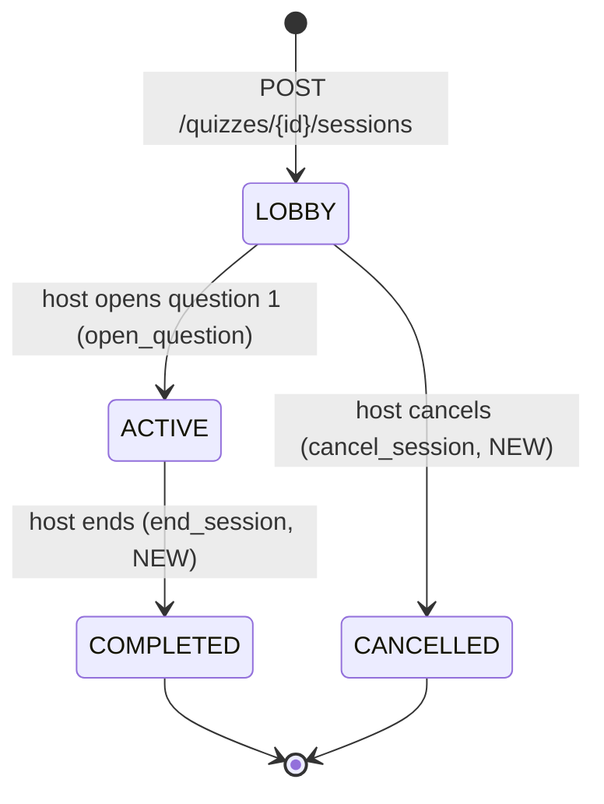
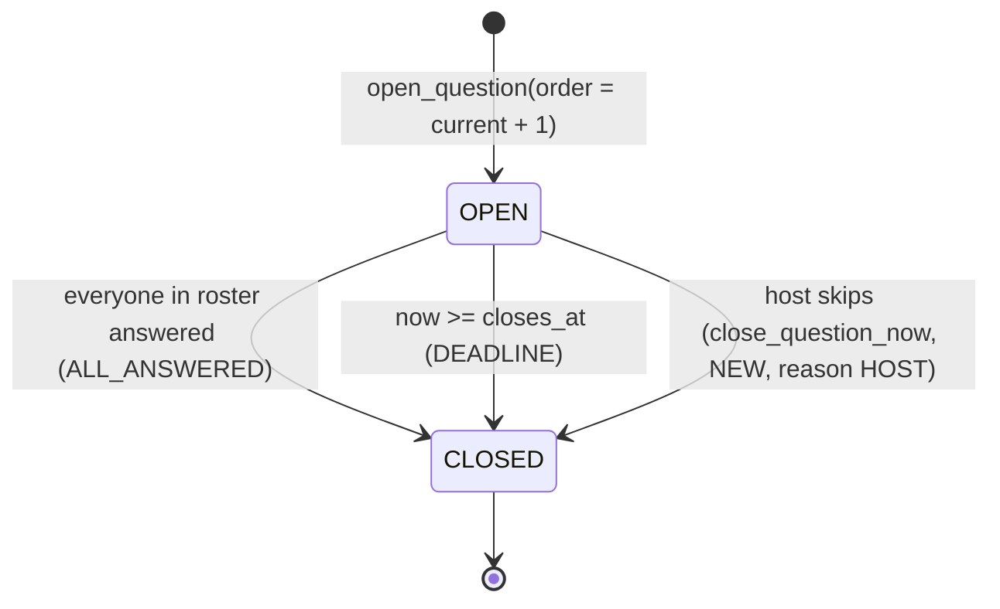
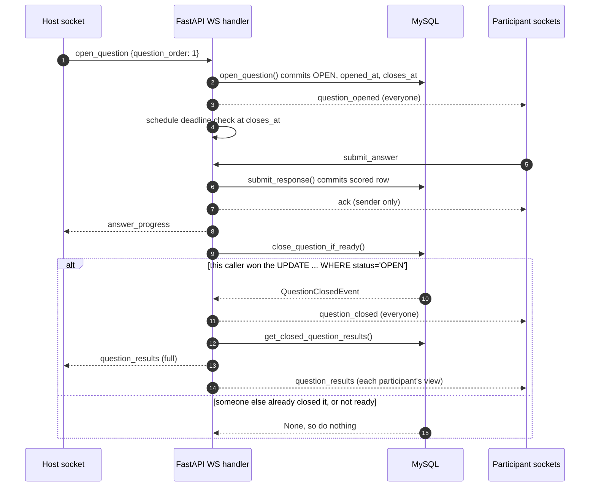

# Live session protocol

How a host and participants play a quiz in real time. This is the contract between the FastAPI WebSocket handler (not written yet) and the React live screens (not written yet). Both sides build against this file. If the code needs to differ, change this file in the same PR.

It builds on code already in `main`:

| Piece | Where | What it gives us |
|---|---|---|
| Create / join a session | `services/sessions.py` (#28) | `live_session` in `LOBBY`, six-digit code, `session_participant` rows |
| Open / close a question | `services/live_questions.py` (#35) | `open_question()`, `close_question_if_ready()`, `QuestionOpenedEvent`, `QuestionClosedEvent` |
| Submit and score an answer | `services/responses.py`, `services/scoring.py` (#27) | `submit_response()`, speed score, hidden until close |
| Results after a question | `services/results.py` (#34) | `get_closed_question_results()` → `ClosedQuestionResultsSnapshot` |

**The rule behind everything here: the database is the source of truth, and the WebSocket only carries news about it.** Every command runs a service function that commits to MySQL first. Only then does the server send events. A client that reconnects is sent a fresh snapshot built from the database, not a replay of messages it missed.

## 1. State machines

### Session (`live_session.status`)



- **Joining** (`POST /sessions/join`) works in `LOBBY` and `ACTIVE`. Someone who joins while a question is open waits for the next one, because they are not in that question's roster (§5).
- `active_join_code` is a generated column that becomes `NULL` once the session reaches `COMPLETED` or `CANCELLED`, so the code can be reused.
- `ended_at` is set on `COMPLETED` and on `CANCELLED`.

### Question (`session_question.status`)



- Questions open strictly in order. Only one can be open at a time, and a closed question never reopens. All of this is enforced by `open_question()`.
- The server sets `opened_at` and `closes_at`. The client's clock is only used to draw the countdown.
- The `PENDING` status exists in the schema but is unused: a row is created already `OPEN`.

## 2. Connection

```
ws(s)://<api-host>/ws/sessions/{session_id}
```

One endpoint for hosts and participants alike. The server works out the role from the database: `live_session.host_id` means host, and a `session_participant` row with `left_at IS NULL` means participant. Anyone else is refused. Admins get no live access in the MVP (§9).

### Authentication: first message, not URL

Browsers can't set an `Authorization` header on a WebSocket. Putting the token in the URL would leak it into server and proxy logs. So:

1. The client connects and must send `{"type": "auth", "token": "<Auth0 access token>"}` as its **first message within 5 seconds**.
2. The server verifies it with the same code as HTTP (`current_user` → `get_or_create_account`), checks that `is_active` is true, and resolves the role.
3. On success, the server sends `session_state` (§4). On failure, it closes the socket with a code from §7.

The access token's expiry is checked only at connect time. A connection that outlives the token stays open, and its next reconnect needs a fresh token, which `getAccessTokenSilently()` provides.

### Keep-alive

The client sends `{"type": "ping"}` every 25 s and the server answers `{"type": "pong"}`. After 60 s of silence the server drops the socket. Dropping a socket **does not** remove the participant from the session (§5).

## 3. Message format

Every message in either direction is one JSON object with a `type` field. Event payloads are **flat**, the same shape as the Pydantic models already in `schemas/live_question.py`, rather than wrapped in `{type, data}`.

A command may carry an optional `request_id` (any string the client chooses). The `ack` or `error` the server sends back includes the same `request_id`, so the client can match the reply to its button press.

Times are ISO-8601 UTC strings. The server's DB timestamps have no timezone, so the server appends `Z` when it serializes them.

## 4. Events

### Client → server

| `type` | Who | Fields | Server action |
|---|---|---|---|
| `auth` | anyone, first message | `token` | §2 |
| `ping` | anyone | — | reply `pong` |
| `open_question` | host | `question_order` | `open_question()` → broadcast `question_opened`, schedule the deadline check (§6) |
| `close_question` | host | `session_question_id` | **NEW**: force-close now with reason `HOST`, then the same steps as an automatic close |
| `submit_answer` | participant | `session_question_id`, `choice_id` | `submit_response()` → `ack` to the sender only → `close_question_if_ready()` (§6) |
| `end_session` | host | — | **NEW** `end_session()`: closes any open question, writes `result` rows, sets `COMPLETED` → broadcast `session_ended` |
| `cancel_session` | host, `LOBBY` only | — | **NEW** `cancel_session()` → `CANCELLED` → broadcast `session_ended` with `reason: "CANCELLED"` |
| `leave` | participant | — | **NEW**: sets `left_at` and closes the socket |

`POST /sessions/{id}/questions/{qid}/responses` stays as it is. It must run the same after-answer hook (`close_question_if_ready` + broadcast) as `submit_answer`, so it can't become a back door that never closes questions. The live UI uses `submit_answer`.

### Server → client

| `type` | To | Payload |
|---|---|---|
| `session_state` | the one client, on (re)connect | snapshot, see below |
| `participant_joined` / `participant_left` | host | `session_participant_id`, `display_name`, `participant_count` |
| `question_opened` | everyone | `QuestionOpenedEvent` (no correctness, just as today) |
| `answer_progress` | host | `session_question_id`, `answered_count`, `eligible_count` (sent after each answer) |
| `question_closed` | everyone | `QuestionClosedEvent` (`reason` ∈ `ALL_ANSWERED`, `DEADLINE`, `HOST`) |
| `question_results` | host | the full `ClosedQuestionResultsSnapshot` |
| `question_results` | each participant | **participant view**: `correct_choice_ids`, per-choice `response_count`, *their own* row (`selected_choice_id`, `is_correct`, `points_awarded`, `cumulative_score`, `rank`), and `leaderboard`: top 5 `{display_name, cumulative_score, rank}` |
| `host_status` | participants | `{"connected": bool}` |
| `session_ended` | everyone | `reason` ∈ `COMPLETED`, `CANCELLED`, plus the final top 5 |
| `ack` | the sender | `request_id`, plus a `ResponseReceipt` for answers |
| `error` | the sender | `request_id`, `code`, `message` (§7) |
| `pong` | the sender | — |

**`session_state` snapshot** (sent on every connect and reconnect):

```json
{
  "type": "session_state",
  "role": "host | participant",
  "session": { "session_id": 12, "status": "ACTIVE", "join_code": "482913",
               "current_question_order": 3, "total_questions": 10 },
  "participant_count": 24,
  "host_connected": true,
  "current_question": null,
  "my_answer": null,
  "last_results": null
}
```

- If a question is `OPEN`, `current_question` is its `question_opened` payload. For a participant, `my_answer` is `{choice_id, submitted_at}` if they already answered, so a refresh shows "answer submitted" instead of the choices again.
- If the latest question is `CLOSED`, `last_results` is that client's `question_results` view.
- `join_code` is sent to the host only.

**Who sees what.** Correctness and points stay hidden until `question_closed` (rule from #27). After that, participants see only their own row plus the top-5 board, and the host gets every row. `results.py` returns everything, so **the WebSocket layer must cut the data down to the participant view before sending it.** The results service performs no permission check of its own.

## 5. Rosters, disconnects and reconnects

- **Roster = joined, not connected.** Eligibility for a question is "had an un-left `session_participant` row when it opened" (`answer_progress()` in #35). A dropped socket does **not** shrink the roster. If someone's Wi-Fi dies, the question waits for the deadline rather than closing early without them. Only an explicit `leave` sets `left_at`.
- **Reconnect** means connect + `auth` again. The server replies with `session_state`, and the client renders from that snapshot alone. Duplicate answers are still rejected (`response_already_submitted`), so a client that retries after reconnecting is safe.
- **Host disconnects:** the session is not ended. Open questions keep their server timers and still close on schedule. Participants get `host_status {connected:false}` and see a "waiting for host" state. When the host reconnects they get `session_state` and carry on. In the MVP a `LOBBY` or `ACTIVE` session with no host stays open indefinitely (see open question 2).
- **Same account, two tabs:** the newest socket replaces the older one, which is closed with `4409`.

## 6. Closing a question exactly once



Three paths can close a question: the last answer, the deadline timer, and the host. All three call the same function. `close_question_if_ready()` (#35) flips `OPEN → CLOSED` with a single conditional `UPDATE`, so exactly one caller gets the event back. **Only the caller that gets a non-`None` event broadcasts.** That rule is what stops duplicate `question_closed` messages.

- **Deadline timer:** an `asyncio` task sleeps until `closes_at` (+250 ms of slack), then calls `close_question_if_ready()`. If the server restarts, the timers are lost. To cover that, a sweep runs at startup and on each connect, closing every `OPEN` question whose `closes_at` has passed.
- **Host force-close:** this needs a small addition to #35's service, a `close_question_now()` that uses the same conditional `UPDATE` with reason `HOST`.

## 7. Errors and close codes

Command errors are sent as `{"type":"error","request_id","code","message"}`, using the **same `code` strings as the HTTP API**. Examples: `session_host_denied`, `question_order_invalid`, `previous_question_not_closed`, `question_already_open`, `session_has_no_participants`, `question_not_open`, `response_deadline_passed`, `response_already_submitted`, `choice_not_for_question`. An error leaves the socket open.

Problems with the connection itself close the socket:

| Close code | Meaning | Client should |
|---|---|---|
| `1000` | Session ended normally | Show final screen |
| `4400` | Malformed message / first message wasn't `auth` | Bug: log it |
| `4401` | Missing, invalid or expired token; auth timeout | Get a new token, reconnect once, then send to login |
| `4403` | Not the host or a participant of this session, or account inactive | Send to dashboard |
| `4404` | Session not found | Send to dashboard |
| `4409` | Replaced by a newer connection from the same account | Show "opened in another tab" |
| `4410` | Session is `COMPLETED` / `CANCELLED` | Show final screen |
| `1011` | Server error | Reconnect with backoff (1 s, 2 s, 4 s … max 30 s) |

## 8. Implementation rules

1. **One DB session per command.** Open a fresh `Session` from `app.state.database.session_factory` for each incoming message and close it straight after. Never hold one for the life of the socket. `open_question()` takes a row lock (`SELECT … FOR UPDATE`), and a long-lived session that errors would keep that lock until it closes.
2. **Commit, then broadcast.** Never send news about something that wasn't committed.
3. **One process.** The connection registry (`session_id → sockets`) lives in memory, so the MVP runs **one uvicorn worker**. Running several workers would need Redis pub/sub, which is out of scope.
4. **Validate every incoming message with a Pydantic model using `extra="forbid"`**, the same pattern as `ResponseSubmit`. Participants only ever send IDs and never scores or times.
5. **Tests:** use Starlette's `TestClient.websocket_connect`, overriding the auth dependency the same way the HTTP tests do. The PoC must have a test with one host and two participants: open a question, both answer, exactly one `question_closed` arrives, a reconnecting client gets `session_state`.

## 9. Open questions (decide at the next meeting)

1. **Leaderboard for participants:** top 5 + your own rank (proposed here), or your own rank only? → Taha, depending on the approved screens.
2. **Abandoned sessions:** auto-cancel a `LOBBY` with no host after N minutes, and auto-end an `ACTIVE` one? Proposal: not in the MVP.
3. **Admin access to live sessions:** watch-only, or none? Proposal: none in the MVP. Admins see results afterwards (Sprint 4).
4. **Host as player:** the schema forbids the host being a participant (`host_cannot_join`). Keep it that way.

## 10. Work this unlocks (in order)

1. **WebSocket PoC** (Nick): the `/ws/sessions/{id}` endpoint, `auth`, the connection registry, `session_state`, `open_question` → `question_opened`, `submit_answer` → `ack`, the after-answer close hook, the deadline timer, plus the two-participant test.
2. **Missing services:** `end_session()` (writes `result` rows using `RANK()`, as `0003` requires), `cancel_session()`, `leave_session()`, `close_question_now()`.
3. **Participant-view filter** for `question_results` (§4).
4. **Frontend:** a `useLiveSession(sessionId)` hook that owns the socket, reconnects with backoff and keeps the latest `session_state`; the screens render from it.
