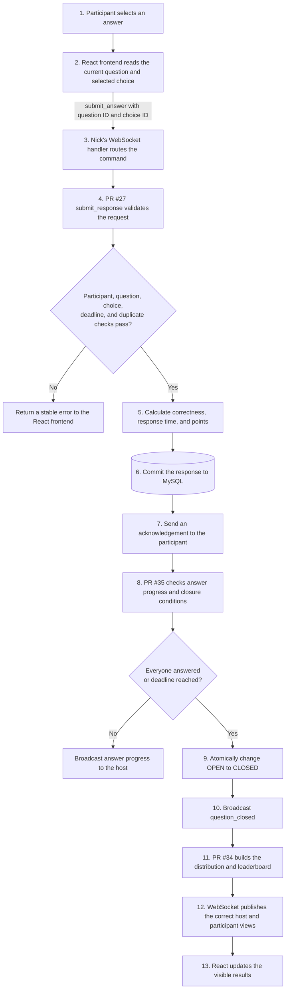

# How the Live Quiz Backend Fits Together

This document explains how my three merged backend contributions work together with Nick's WebSocket layer and the React frontend:

- [PR #27](https://github.com/sudo-nickPinto/CS440-Quiz-Platform/pull/27): response validation and server-side scoring
- [PR #35](https://github.com/sudo-nickPinto/CS440-Quiz-Platform/pull/35): server-controlled question lifecycle
- [PR #34](https://github.com/sudo-nickPinto/CS440-Quiz-Platform/pull/34): closed-question results and cumulative leaderboard

The short version is: **the frontend shows the game, the WebSocket carries events, the backend services enforce the rules, and MySQL stores the truth.**

## Why these services are needed

A participant controls their browser, so the browser cannot be trusted to decide:

- when an answer arrived;
- whether the answer is correct;
- how many points it earns;
- whether the question should close; or
- which results are safe to reveal.

Those decisions belong to the backend. The client sends identifiers, such as a question ID and choice ID. The backend verifies the request against stored session data, calculates the result using server time, commits it, and only then broadcasts an update.

## Ownership and system boundaries

| Layer | Responsibility | Main ownership |
|---|---|---|
| React frontend | Displays the lobby, question, controls, feedback, and leaderboard | Anindo and frontend team |
| WebSocket transport and hub | Authenticates connections, routes commands, and broadcasts committed events | Nick |
| Response and scoring services | Validate, calculate, and save an answer | My contribution, PR #27 |
| Question lifecycle service | Open questions, track progress, and close once | My contribution, PR #35 |
| Results service | Build answer distributions and cumulative rankings | My contribution, PR #34 |
| MySQL | Persist sessions, questions, participants, responses, and scores | Shared system database |

The WebSocket does not duplicate the quiz rules. It calls the same backend services used by the REST API.

## Big-picture flow



The main path runs from step 1 at the top to step 13 at the bottom. An invalid answer leaves the main path at the validation decision and returns an error without changing the database. A valid answer is scored and committed before the lifecycle and results services run.

## One answer, traced end to end

Assume Alice selects choice `302` for live question `81`.

### 1. The frontend sends IDs only

`frontend/src/live/liveSession.js` sends:

```json
{
  "type": "submit_answer",
  "session_question_id": 81,
  "choice_id": 302
}
```

It does not send the answer time, correctness, or points. Those are server-owned facts.

### 2. Nick's WebSocket layer routes the command to my service

The WebSocket authenticates before it accepts quiz commands. The browser first sends its Auth0 token. `authenticate_token()` validates that token and creates a `CurrentAccount`, and the WebSocket stores it as `conn.account` together with the session ID and connection role.

Later, when the participant submits an answer, the `SubmitAnswerMessage` branch in `backend/app/api/routes/live.py`:

1. validates the message shape;
2. passes `conn.account`, `conn.session_id`, the session-question ID, and choice ID to my `submit_response()` service;
3. acknowledges the committed answer; and
4. calls `hub.after_answer()`.

Nick's layer is therefore the delivery and orchestration mechanism. It does not recreate my validation or scoring rules.

### 3. My PR #27 validates and scores the answer

In `backend/app/services/responses.py`, my `submit_response()` service uses SQLAlchemy queries to compare the authenticated account and submitted IDs with trusted database rows:

- it selects `LiveSession` by `session_id`, so a missing session is rejected;
- it selects `SessionParticipant` using both `session_id` and `account.account_id`, with `left_at` empty, so Alice must be an active participant in this session;
- it selects `SessionQuestion` using both the session and session-question IDs, then checks that the session and question are active;
- it selects `AnswerChoice` by `choice_id` and compares its `question_id` with the current question, so a choice from another question is rejected;
- it compares the server receipt time with the stored opening time and deadline; and
- it searches `Response` for the same participant and session question, so an existing answer is rejected. A database uniqueness constraint is the final protection if two duplicate requests race.

It then calls `calculate_points()` in `backend/app/services/scoring.py` and stores:

- the selected choice;
- the server receipt time;
- response time in milliseconds;
- correctness; and
- awarded points.

Only after `db.commit()` succeeds does the caller receive a successful receipt.

### 4. My PR #35 checks whether the question should close

After the answer commits, Nick's `LiveHub.after_answer()` calls my `answer_progress()` function and broadcasts the returned count to the host. The hub function lives in `backend/app/live/hub.py`; my `answer_progress()`, `close_question_if_ready()`, and `_mark_closed()` functions live in `backend/app/services/live_questions.py`.

`close_question_if_ready()` closes the question when:

- every participant who was eligible when it opened has answered; or
- the server deadline has been reached.

The final database update includes `WHERE status = OPEN`. If the last answer and deadline timer try to close the question simultaneously, only one update succeeds. Only that winner broadcasts `question_closed`, preventing duplicate close events.

### 5. My PR #34 builds safe results

`get_closed_question_results()` first rejects any request for a question that is not closed. After closure, it:

- counts responses for every answer choice, including zero-response choices;
- uses the correctness and points already stored with each response;
- includes participants who did not answer with zero points;
- sums points from closed questions for cumulative scores; and
- assigns competition ranks, so equal scores can produce ranks such as `1, 2, 2, 4`.

The hub then sends different views:

- the host receives the complete result data;
- a participant receives their own detailed result and the limited leaderboard.

PR #34 does not use a database trigger or poll for the deadline. When my PR #35 close function returns a `QuestionClosedEvent`, Nick's hub calls `question_closed()`. That hub function broadcasts the close event and then calls `publish_results()`, which invokes my `get_closed_question_results()` service. This ordinary Python call is the signal that starts the PR #34 result-building work.

My services do not communicate with browser sockets directly. They return receipts, progress values, close events, and result snapshots. Nick's hub receives those returned values and uses its `send()` and `broadcast()` functions to deliver them to the appropriate frontend connections. This separation keeps my game rules reusable and independent from the WebSocket transport.

## How the three PRs depend on each other

```text
PR #35 opens the official answer window
                ↓
PR #27 accepts and scores valid answers during that window
                ↓
PR #35 closes the window once, by answers or deadline
                ↓
PR #34 reveals the stored results and leaderboard after closure
```

Removing any one of them breaks the live game:

- without PR #35, there is no authoritative answer window;
- without PR #27, answers are not safely validated or scored;
- without PR #34, closed questions cannot produce feedback or rankings.

## SRS requirements supported

The implementation primarily supports:

| Requirement | Connection to the implementation |
|---|---|
| `FR-5.4.21` | Backend controls question-open, question-closed, feedback, and progression states. |
| `FR-5.5.4` | Records a participant's response for the current question. |
| `FR-5.5.6`–`FR-5.5.10` | Accepts only the first valid response, rejects late/invalid/duplicate answers, and acknowledges accepted answers. |
| `FR-5.6.1` | Determines correctness on the backend. |
| `FR-5.6.3`–`FR-5.6.5` | Produces post-question feedback, score, position, and leaderboard updates. |
| `FR-5.6.9` | Awards speed-sensitive points using the defined formula. |
| `FR-5.6.10` | Ranks participants by ranking points. |
| `FR-5.6.14`–`FR-5.6.15` | Gives zero points to wrong/unanswered responses and sums accepted points with tie-aware ranking. |

## How it was verified

### Focused verification

Run from `backend/` with Python 3.11 or newer:

```bash
env -u TEST_DATABASE_URL .venv/bin/python -m pytest \
  tests/test_response_service.py::test_correct_response_is_timed_and_scored_by_the_server \
  tests/test_question_closure_service.py::test_everyone_answering_closes_question_early \
  tests/test_results_service.py::test_results_are_hidden_until_question_is_closed \
  tests/test_results_service.py::test_leaderboard_includes_every_participant_and_rank_style_ties \
  tests/test_live_websocket.py::test_host_and_two_participants_play_one_question \
  -v
```

Current expected result:

```text
6 passed, 1 warning
```

The six collected cases prove:

1. correct answers are timed and scored by the server;
2. the last eligible answer can close a question early;
3. pending and open questions keep results hidden;
4. unanswered participants and ties are handled correctly; and
5. one host and two participants can complete the entire question flow over WebSockets.

The warning is the existing Starlette/TestClient deprecation warning, not a failed test.

### Database-specific integration coverage

Real-MySQL coverage lives in:

- `backend/tests/integration/test_response_submission.py`
- `backend/tests/integration/test_question_lifecycle.py`
- `backend/tests/integration/test_question_results.py`
- `backend/tests/integration/test_answer_close_race.py`

These tests verify migrated-schema behavior, database constraints, transactions, persistence, and answer/close races. They must run only against an approved disposable database whose name contains `test`, never the shared `f26_cs440_quizdb` database.

## Live demonstration and code walkthrough

### User-visible behavior

A compact end-to-end demonstration can use <https://quizburg.us.reclaim.cloud> with one host and one or two participants:

1. join the session;
2. open a question;
3. submit the first answer;
4. submit the final participant's answer;
5. observe the automatic closure, answer distribution, and leaderboard.

This visible behavior is the integration of all three contributions. My PR #27 validates and scores each answer. My PR #35 detects that the answer window is complete and closes it once. My PR #34 builds the result data displayed by the frontend. Nick's WebSocket layer carries those committed state changes between the backend and connected browsers.

### Six-step implementation walkthrough

The complete backend path can be followed through these locations:

```bash
code -g backend/app/api/routes/live.py:199
code -g backend/app/services/responses.py:100
code -g backend/app/services/live_questions.py:151
code -g backend/app/services/live_questions.py:175
code -g backend/app/services/results.py:50
code -g backend/app/live/hub.py:321
```

#### 1. Route the command

`backend/app/api/routes/live.py` receives a validated `SubmitAnswerMessage`. The message contains only `session_question_id` and `choice_id`; the authenticated WebSocket connection supplies the account and session. Nick's handler converts the message into `ResponseSubmit` and calls my `submit_response()` service instead of implementing a second set of answer rules.

#### 2. Validate against trusted state

My `backend/app/services/responses.py` service verifies the request using database state. It confirms that the session exists, the account is an active participant, the session question is open, the choice belongs to that question, the deadline has not passed, and no response has already been accepted. Invalid requests produce stable API error codes without changing an existing answer.

#### 3. Score on the server

My response service calculates elapsed time from the server-controlled opening and receipt timestamps. `calculate_points()` awards zero for an incorrect answer and speed-sensitive points for a correct one. Because the browser never supplies correctness, time, or points, changing frontend JavaScript cannot create a valid higher score.

#### 4. Commit before acknowledging

My service creates the `Response` row with the selected choice, timestamp, elapsed time, correctness, and points, and then commits the transaction. Nick's WebSocket acknowledgement is sent only after that commit succeeds. This ordering makes MySQL the source of truth and allows a reconnecting browser to rebuild its state from saved data.

#### 5. Close exactly once

After the committed answer, Nick's `LiveHub.after_answer()` calls my `answer_progress()` and `close_question_if_ready()` functions. The question closes when every eligible participant has answered or when the deadline arrives. My final update matches only a row whose status is still `OPEN`, so simultaneous answer and timer paths cannot both close and broadcast the same question.

#### 6. Publish safe results

The winning close path returns an event to Nick's hub. The hub broadcasts `question_closed` and calls my `get_closed_question_results()` service. My results service reads stored responses, counts choices, adds cumulative points, includes unanswered participants, and assigns tie-aware ranks. The hub then sends the complete view to the host and a limited personal view to each participant.

Together, the six steps form one reliable transaction-to-event pipeline:

```text
route -> validate -> score -> commit -> close once -> publish results
```

### Verification evidence

The focused command above checks this pipeline through named service tests and a complete Host/Alice/Bob WebSocket test. The test names make the verified behavior visible: server scoring, early closure, hidden pre-close results, leaderboard ties, and the full multi-client flow.

## Demonstration fallback

If external connectivity or Auth0 prevents a deployed demonstration, `test_host_and_two_participants_play_one_question` in `backend/tests/test_live_websocket.py` exercises the same flow locally. It creates host, Alice, and Bob connections, opens a question, submits both answers, verifies exactly one closure, and checks the personalized results. The flowchart and six-step walkthrough then connect that automated result to the production implementation.

## Summary

The live quiz is trustworthy because the browser sends only identifiers while the backend owns validation, timing, scoring, persistence, closure, and result visibility. The deployed application demonstrates the complete integration, and the automated tests verify the important normal, error, and concurrency rules.

## Related documentation

- [Live protocol](LIVE_PROTOCOL.md) - complete wire protocol and state rules
- [WebSockets explained](WEBSOCKETS_EXPLAINED.md) - beginner-friendly WebSocket overview
- [REST API reference](API.md) - HTTP endpoints, payloads, and errors
