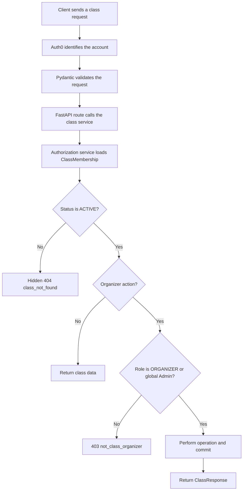

# Tasks 2 and 3: Class CRUD and Authorization Demo

This document explains my Version 2 backend work from [PR #62](https://github.com/sudo-nickPinto/CS440-Quiz-Platform/pull/62) and provides a short classroom demonstration.

- **Task 2 — Class CRUD:** create, view, update, rotate the code for, and archive a class.
- **Task 3 — Class authorization:** make one reusable permission layer protect class operations.

The simplest mental model is:

```text
Auth0 identifies the account.
Task 3 decides what that account may do in this class.
Task 2 performs the allowed class operation.
```

## Why this work matters

Version 1 supported quizzes and live sessions, but it did not have a permanent class container. Version 2 needs classes so memberships, quizzes, sessions, and results can be organized around a group.

Task 2 provides the class-management API. Task 3 prevents a caller from managing a class merely because they know its ID. Permissions are enforced by the backend using database state, not by hiding frontend buttons.

## System flow



## Task 2: Class CRUD API

Task 2 added six REST endpoints:

| Endpoint | Purpose |
| --- | --- |
| `POST /classes` | Create a class and the creator's organizer membership. |
| `GET /classes` | List classes relevant to the current account. |
| `GET /classes/{class_id}` | Read one accessible class. |
| `PATCH /classes/{class_id}` | Rename a class or open/close joining. |
| `POST /classes/{class_id}/code` | Replace the class join code. |
| `POST /classes/{class_id}/archive` | Archive the class without deleting its history. |

Important implementation decisions:

- Class creation and the creator's `ACTIVE/ORGANIZER` membership are committed together. A partial class without an organizer cannot remain.
- `PATCH` changes only the supplied fields.
- Class codes are generated securely, stored without the display dash, and formatted as `XXXX-XXXX` in responses.
- Rotating the code invalidates the old code and reopens joining.
- Archiving is soft and idempotent. It records `archived_at`, closes joining, clears the code, and preserves memberships and historical data.

## Task 3: Reusable class authorization

Task 3 is not another Swagger endpoint. It is the backend security guard used by Task 2 and later class features.

Auth0 and Task 3 answer different questions:

```text
Auth0:  "This request comes from account 42."
Task 3: "Account 42 is an ACTIVE ORGANIZER of class 7."
```

### Database-backed permissions

Each person's relationship with each class is stored in `class_membership`:

| class_id | account_id | status | role |
| ---: | ---: | --- | --- |
| 7 | 42 | `ACTIVE` | `ORGANIZER` |

- `status` determines whether the relationship currently grants access.
- `role` determines what an active member may do.
- The same account can organize one class and be an ordinary member of another.

### Permission table

| Caller | Read class | Rename, rotate code, or archive |
| --- | ---: | ---: |
| Global Admin | Allowed | Allowed |
| Active organizer | Allowed | Allowed |
| Active member | Allowed | `403 not_class_organizer` |
| Invited user | Hidden `404` | Hidden `404` |
| Left or removed member | Hidden `404` | Hidden `404` |
| Outsider | Hidden `404` | Hidden `404` |

An active member receives `403` for an organizer-only operation because that person already has access to the class. An outsider or inactive membership receives the same hidden `404` as a nonexistent class, which avoids revealing private classes.

### One PATCH request from beginning to end

Alice submits:

```http
PATCH /classes/7
```

```json
{
  "name": "CS 440 Fall 2026"
}
```

The backend performs these steps:

1. `get_active_account` identifies Alice and confirms that her account is active.
2. `ClassUpdate` validates and normalizes the JSON body.
3. `update_class_route()` passes the database session, account, class ID, and payload to `update_class()`.
4. `update_class()` calls `require_class_organizer()` before changing the class.
5. `require_class_member()` loads class 7 and Alice's `ClassMembership` row.
6. The membership must have `status == ACTIVE`.
7. The organizer check then requires `role == ORGANIZER`; a global Admin may bypass the membership requirement.
8. Only after authorization succeeds does the service change the requested fields.
9. The transaction commits.
10. The updated `ClassResponse` returns with `200 OK`.

The safety boundary is between steps 7 and 8. A denied request never reaches the database update or commit.

### Member and organizer comparison

```text
ACTIVE MEMBER
  member check passes
  organizer check fails
  response: 403 not_class_organizer
  database: unchanged

ACTIVE ORGANIZER
  member check passes
  organizer check passes
  requested fields change
  transaction commits
  response: 200 OK
```

## Implementation map

| File | Responsibility |
| --- | --- |
| `backend/app/api/routes/classes.py` | Defines the six HTTP endpoints and receives dependencies. |
| `backend/app/schemas/classes.py` | Validates create, update, and response data. |
| `backend/app/services/classes.py` | Performs class creation, listing, updates, code rotation, and archival. |
| `backend/app/services/class_authorization.py` | Loads memberships and enforces member/organizer rules. |
| `backend/app/models/classes.py` | Maps `Class` and `ClassMembership` database rows. |
| `backend/tests/test_class_authorization.py` | Verifies the permission matrix. |
| `backend/tests/test_class_api.py` | Verifies permissions through the HTTP API. |

The permission rules are centralized instead of copied into every route. This keeps current and future class features consistent.

## Classroom demonstration

The demonstration has three parts:

1. Use Swagger to show Task 2's visible API behavior.
2. Trace one `PATCH` request into Task 3's authorization helper.
3. Run focused tests to prove both allowed and denied permission paths.

### 1. Start a safe local Swagger server

Run from `backend/` with Python 3.11 or newer. This creates a disposable SQLite database and a local organizer identity. It does not read MySQL credentials or contact the shared database.

<details>
<summary>Local demo server command</summary>

```bash
.venv/bin/python - <<'PY'
import tempfile
from pathlib import Path

import uvicorn

from app.auth import CurrentAccount, get_active_account
from app.config import Settings
from app.database import Base, Database
from app.main import create_app
from app.models import Account, AccountRole

with tempfile.TemporaryDirectory(prefix="cs440-class-demo-") as demo_dir:
    database_url = f"sqlite:///{Path(demo_dir) / 'demo.db'}"
    bootstrap = Database(database_url)
    Base.metadata.create_all(bootstrap.engine)

    with bootstrap.session_factory() as db:
        account = Account(
            auth0_sub="demo|class-organizer",
            email="class-demo@test.invalid",
            display_name="Class Demo Organizer",
            account_type=None,
        )
        db.add(account)
        db.commit()
        identity = CurrentAccount(
            account_id=account.account_id,
            role=AccountRole.USER,
            is_active=True,
        )

    bootstrap.dispose()
    app = create_app(Settings(database_url=database_url))
    app.dependency_overrides[get_active_account] = lambda: identity
    uvicorn.run(app, host="127.0.0.1", port=8001, log_level="info")
PY
```

</details>

Open <http://127.0.0.1:8001/docs> and expand the **classes** section.

### 2. Create a class in Swagger

Use `POST /classes`:

```json
{
  "name": "CS 440 Demo"
}
```

Expected result: `201 Created`.

```json
{
  "class_id": 1,
  "name": "CS 440 Demo",
  "created_by_id": 1,
  "join_code": "ABCD-EFGH",
  "joining_open": true,
  "archived_at": null,
  "created_at": "2026-10-28T12:00:00",
  "updated_at": "2026-10-28T12:00:00",
  "current_role": "ORGANIZER",
  "membership_status": "ACTIVE"
}
```

The generated code and timestamps will differ. The response demonstrates that class creation also created the caller's active organizer membership.

### 3. Update the class in Swagger

Use `PATCH /classes/{class_id}` with the returned class ID:

```json
{
  "name": "CS 440 Fall 2026",
  "joining_open": false
}
```

Expected result: `200 OK`, with the new name and `joining_open: false`.

This successful request demonstrates the organizer path. The local identity created the class, so its membership is `ACTIVE/ORGANIZER`.

An empty body demonstrates schema validation:

```json
{}
```

Expected result: `422 request_validation_error`.

### 4. Trace the authorization code

From `backend/`:

```bash
code -g app/api/routes/classes.py:45
code -g app/schemas/classes.py:21
code -g app/services/classes.py:180
code -g app/services/class_authorization.py:30
```

The important service line is:

```python
access = require_class_organizer(db, account, class_id)
```

The helper first requires an active membership and then requires the organizer role. Because the helper runs before field assignment and `_commit()`, failed authorization cannot modify the class.

### 5. Demonstrate and interpret the tests

I wrote automated test cases for each important authorization decision and then ran them with `pytest`. The quick presentation uses three complementary test levels:

| Test file | Test type | What it proves |
| --- | --- | --- |
| `tests/test_class_authorization.py` | Service-level unit tests | The permission helpers return the correct access or error for each membership state. |
| `tests/test_class_api.py` | API tests | FastAPI routes, schemas, services, authorization, and the database work together correctly. |
| `tests/test_class_schemas.py` | Schema unit tests | Valid request bodies are normalized and invalid bodies are rejected. |

The service-level authorization tests do not start a browser or make a network request. They create isolated database records and call `require_class_member()` or `require_class_organizer()` directly. This makes each permission rule fast and deterministic.

#### How each authorization test works

The tests follow **Arrange–Act–Assert**:

```text
Arrange: create accounts, a class, and ClassMembership rows
Act:     call the authorization helper as one account
Assert:  verify access, or the exact HTTP status and error code
```

For example, the active-member denial test arranges an `ACTIVE/MEMBER` membership, calls `require_class_organizer()`, and asserts `403 not_class_organizer`. The organizer test uses an `ACTIVE/ORGANIZER` membership and asserts that access is returned. The denial happens before any class update, so no database state changes.

The reusable fixture creates several identities in one isolated SQLite database:

```text
outsider, invited, left, removed, member, organizer, global Admin
```

That lets the tests verify the full permission table without changing real application data.

#### Run the authorization tests visibly

Stop the demo server with `Ctrl+C`, or use a second terminal. From `backend/`:

```bash
env -u TEST_DATABASE_URL .venv/bin/python -m pytest \
  tests/test_class_authorization.py \
  -v
```

`-v` prints each test name, which makes the result understandable during a presentation. Representative output looks like:

```text
test_outsider_receives_hidden_class_not_found PASSED
test_active_member_passes_member_check PASSED
test_active_member_is_not_class_organizer PASSED
test_active_organizer_passes_member_and_organizer_checks PASSED
test_global_admin_bypasses_member_and_organizer_checks PASSED
...
19 passed
```

The output can be read as follows:

- `collected 19 items` means pytest found 19 individual cases, including parameterized membership states.
- Each `PASSED` line identifies the behavior that was exercised successfully.
- `[100%]` means every collected case ran.
- `19 passed` means no authorization assertion failed or raised an unexpected error.
- A warning is reported separately and does not mean a test failed.

The most direct member-versus-organizer comparison is:

```bash
env -u TEST_DATABASE_URL .venv/bin/python -m pytest \
  tests/test_class_authorization.py::test_active_member_is_not_class_organizer \
  tests/test_class_authorization.py::test_active_organizer_passes_member_and_organizer_checks \
  -v
```

Expected result:

```text
2 passed
```

The first passing test proves that an active member receives the expected denial. The second proves that an active organizer passes the same reusable check.

#### Prove the same rule through the HTTP API

The authorization unit tests prove the decision itself. These API tests prove that the Task 2 endpoints actually use that decision:

```bash
env -u TEST_DATABASE_URL .venv/bin/python -m pytest \
  tests/test_class_api.py::test_member_cannot_rename_rotate_or_archive \
  tests/test_class_api.py::test_organizer_and_global_admin_can_rename \
  -v
```

Expected result:

```text
2 passed
```

The first test sends protected mutation requests as an active member and verifies `403 not_class_organizer`. The second sends rename requests as an organizer and global Admin and verifies `200 OK` with the updated name.

#### Broader focused verification

```bash
env -u TEST_DATABASE_URL .venv/bin/python -m pytest \
  tests/test_class_authorization.py \
  tests/test_class_api.py \
  tests/test_class_schemas.py \
  -q
```

Current expected result:

```text
58 passed, 1 warning
```

With `-q`, each dot represents one passing case and the final line gives the total. The warning is the existing Starlette/TestClient deprecation warning, not a Class CRUD or authorization failure.

`env -u TEST_DATABASE_URL` deliberately keeps this quick demonstration on isolated SQLite databases. It does not claim to be a real-MySQL run. Before PR #62 merged, the Class CRUD scenarios were also verified against a migrated disposable MySQL test database; the shared `f26_cs440_quizdb` database was never used for testing.

## Presentation summary

My Task 2 contribution added the REST operations needed to create and manage permanent classes. My Task 3 contribution added the reusable authorization layer that checks each caller's database-backed class relationship before protected operations run.

The key design decision was to separate responsibilities:

```text
route receives -> schema validates -> authorization decides
-> service changes -> database commits -> response returns
```

This separation keeps the API easier to test, prevents duplicated permission rules, protects private classes, and gives later class features the same security foundation.

## Demonstration fallback

If Swagger is unavailable, the code trace and focused tests still demonstrate the complete design:

1. Show the six routes in `backend/app/api/routes/classes.py`.
2. Follow `update_class()` into `require_class_organizer()`.
3. Compare the active-member and organizer tests.
4. Run the 19 authorization tests.
5. Open merged [PR #62](https://github.com/sudo-nickPinto/CS440-Quiz-Platform/pull/62).
