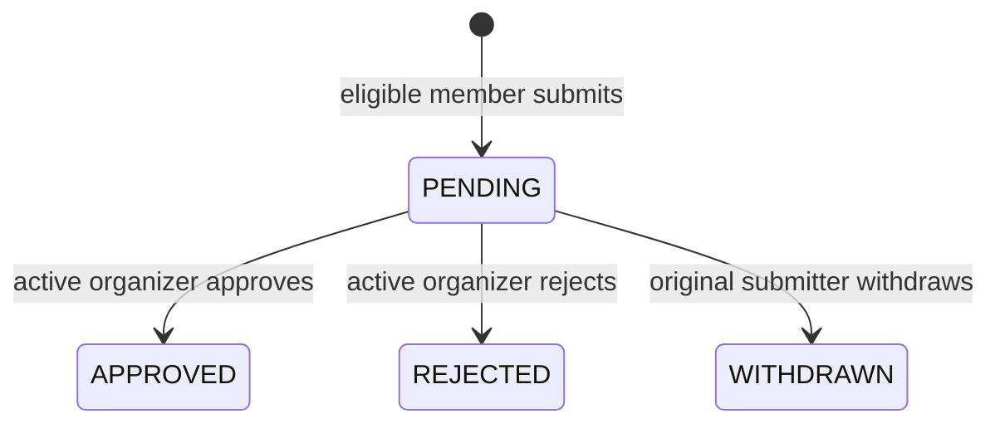

# V3 Task 4: Class Quiz Submission and Approval

**Owner:** Pronob

**Status:** Backend implemented; Task 5 hosting integration remains separate

**Last updated:** November 4, 2026

## Purpose

Task 4 adds the approval step between publishing a quiz version and hosting that
version in a class. An active class member may submit an eligible immutable quiz
version, and an active organizer of that same class may approve or reject it.
Only an approved, current version should appear in the class's hostable quiz
list.

Task 4 now includes migration `0010_quiz_submission`, the SQLAlchemy model,
strict schemas, API routes, service rules, and focused tests. It intentionally
does not change session creation or any live-session behavior; Task 5 will call
the reusable approval helper.

## Dependency Status and Ownership

Task 4 depends on the final contracts from Tasks 1 through 3.

| Dependency | Interface Task 4 uses | Final status |
|---|---|---|
| Task 1: Admin semantics | Active class membership is required; only active faculty `ORGANIZER`s decide. Faculty has no global bypass. | Merged and used through `class_authorization`. |
| Task 2: Class-scoped quizzes | `quiz.class_id`, class quiz endpoints, and migration `0008_quiz_class`. | Merged; `quiz.class_id` is authoritative. |
| Task 3: Sharing and locking | Active collaborator state, immutable publication, and migration `0009_quiz_collaboration`. | Merged and used by submission eligibility checks. |

The final migration order is:

1. Task 2: `0008_quiz_class`
2. Task 3: `0009_quiz_collaboration`
3. Task 4: `0010_quiz_submission`

## Final Data Model

Table: `quiz_submission`

| Field | Type and rule | Purpose |
|---|---|---|
| `submission_id` | Unsigned integer primary key | Identifies one submission attempt. |
| `class_id` | Required foreign key to `class.class_id` | Class receiving the submission. |
| `quiz_version_id` | Required foreign key to `quiz_version.quiz_version_id` | Immutable version being reviewed. |
| `submitted_by_id` | Required foreign key to `account.account_id` | Member who submitted the version. |
| `status` | Enum: `PENDING`, `APPROVED`, `REJECTED`, `WITHDRAWN` | Current review state. |
| `decided_by_id` | Nullable foreign key to `account.account_id` | Organizer who approved or rejected, or submitter who withdrew. |
| `submitted_at` | Required UTC timestamp | When the submission was created. |
| `decided_at` | Nullable UTC timestamp | When the pending state ended. |

Final invariants:

- The submitted version must be published and immutable.
- The version's quiz must belong to `class_id`.
- At submission time, the caller must be an active member of the class and
  either the quiz owner or an active, non-revoked collaborator.
- An active organizer may decide a submission only while the organizer remains
  active in that class.
- `decided_by_id` and `decided_at` are null while the status is `PENDING` and
  are set together when the status becomes terminal.
- Submission history is retained. Rejection and withdrawal never delete the
  database row.
- Only one active submission may exist for the same class and quiz version.
  Active means `PENDING` or `APPROVED`.
- A stored generated `active_version_id` equals `quiz_version_id` for
  `PENDING`/`APPROVED`, otherwise `NULL`. The unique key on
  `(class_id, active_version_id)` makes active duplicates concurrency-safe
  while allowing rejected or withdrawn versions to be submitted again.

All class, version, submitter, and decision-actor foreign keys use `RESTRICT`
to preserve the audit trail.

## Final State Machine



| Current status | Action | Actor | Result | Audit update |
|---|---|---|---|---|
| No submission | Submit eligible version | Active owner or collaborator | `PENDING` | Set `submitted_by_id` and `submitted_at`. |
| `PENDING` | Approve | Active class organizer | `APPROVED` | Set organizer as `decided_by_id` and set `decided_at`. |
| `PENDING` | Reject | Active class organizer | `REJECTED` | Set organizer as `decided_by_id` and set `decided_at`. |
| `PENDING` | Withdraw | Original submitter | `WITHDRAWN` | Set submitter as `decided_by_id` and set `decided_at`. |
| Terminal | Any transition | Any actor | Reject with `409` | Do not change the row. |

`APPROVED`, `REJECTED`, and `WITHDRAWN` are terminal for that submission row.
A new submission row may be created after rejection or withdrawal if the
version remains eligible.

## Implemented API Contract

All endpoints require an active authenticated account. A missing class and a
class that the caller may not access must produce the same non-leaking
`404 class_not_found` response.

### Submit a quiz version

`POST /classes/{class_id}/quiz-submissions`

Request:

```json
{
  "quiz_version_id": 321
}
```

Result: `201 Created` with the submission response.

The service verifies class membership, quiz ownership or active collaboration,
class ownership of the quiz, publication of the version, and the absence of an
active duplicate in one transaction. An archived class rejects new submissions
with `409 class_archived`.

### List submissions

`GET /classes/{class_id}/quiz-submissions`

Visibility:

- Active organizers see all submissions in the class.
- Other active members see only submissions they created.
- Being an unrelated `ADMIN` grants no visibility.
- Results are newest first. Pagination remains Task 6 work.

### Decide a submission

`PATCH /classes/{class_id}/quiz-submissions/{submission_id}`

Request:

```json
{
  "status": "APPROVED"
}
```

The only accepted values are `APPROVED` and `REJECTED`. Only an active faculty
organizer of this class may decide a pending submission; self-approval is
allowed. Approval rechecks that the version is still published, current, and
in the class, and that the submitter is still active and still owns or actively
collaborates on the quiz. Lost submitter eligibility blocks approval with
`submission_no_longer_eligible`. An archived class blocks approval with
`class_archived`; rejection remains available to close pending records.

### Withdraw a submission

`DELETE /classes/{class_id}/quiz-submissions/{submission_id}`

Result: `204 No Content` after changing the status to `WITHDRAWN`.
This endpoint never physically deletes a row. Only the original submitter may
withdraw, and only while the status is `PENDING`. Withdrawal remains available
after class archival so the pending record can be closed cleanly.

### List approved quizzes

`GET /classes/{class_id}/approved-quizzes`

Active class members may retrieve approved, currently hostable immutable
versions. Archived classes return `409 class_archived` and never return a
hostable list. An item includes:

- `submission_id`
- `quiz_id`
- `quiz_version_id`
- `version_number`
- `title`
- `author_id`
- `approved_at`
- `approved_by_id`

This response grants availability only. It does not grant edit access, class
management, hosting permission, report access, or results access.

## Submission Response

```json
{
  "submission_id": 42,
  "class_id": 7,
  "quiz_version_id": 321,
  "submitted_by_id": 18,
  "status": "PENDING",
  "decided_by_id": null,
  "submitted_at": "2026-11-01T15:30:00Z",
  "decided_at": null
}
```

## Authorization Matrix

| Caller | Submit eligible version | List submissions | Approve/reject | Withdraw own pending submission | View approved quizzes |
|---|---:|---|---:|---:|---:|
| Active quiz owner and class member | Yes | Own | Only if also organizer | Yes | Yes |
| Active collaborator and class member | Yes | Own | Only if also organizer | Yes | Yes |
| Active ordinary member without quiz access | No | Own, if any | No | Own only | Yes |
| Active faculty organizer | Only when owner or collaborator | All in class | Yes | Own only | Yes |
| Invited, removed, or departed member | No | Hidden `404` | No | No | No |
| Unrelated `ADMIN` | No global bypass; hidden `404` | Hidden `404` | No | No | No |
| Outsider | Hidden `404` | Hidden `404` | Hidden `404` | Hidden `404` | Hidden `404` |

Revoked collaborators and removed class members lose submission eligibility
immediately. A pending submission from someone who later loses account,
membership, ownership, or collaborator access remains in the audit history but
cannot be approved. An organizer may still reject it.

## Final Errors

| HTTP status | Code | When returned |
|---:|---|---|
| `404` | `class_not_found` | Class does not exist or caller lacks active access. |
| `404` | `submission_not_found` | Submission does not exist in this class or is not visible to the caller. |
| `404` | `quiz_version_not_found` | Version does not exist, belongs to another class, or is not visible. |
| `403` | `not_submission_owner` | Caller can see the submission but is not its original submitter. |
| `403` | `not_class_organizer` | Caller can see the submission but is not an active faculty organizer. |
| `409` | `quiz_version_not_published` | Version is mutable or unpublished. |
| `409` | `class_archived` | Archived class receives a new submission or approval, or is checked for hostable quizzes. |
| `409` | `quiz_submission_conflict` | An active submission already exists for the class and version. |
| `409` | `invalid_submission_transition` | Requested action is not valid from the current status. |
| `409` | `quiz_version_stale` | Version is no longer the current publishable version. |
| `409` | `submission_no_longer_eligible` | Approval recheck finds that the submitter lost account, membership, ownership, or active collaborator eligibility. |
| `409` | `quiz_version_not_approved` | The Task 5 helper is asked for a version that is not currently approved and hostable. |

Create, decide, and withdraw database failures use
`quiz_submission_failed`, `quiz_submission_decision_failed`, and
`quiz_submission_withdrawal_failed`. Inaccessible submissions always return
`404 submission_not_found`; 403 responses are reserved for visible resources.

## Final Stale-Version Rule

A version becomes stale for new approval or hosting when the same quiz has a
newer published immutable version. Publishing the newer version does not delete
or rewrite the older submission. The older approval remains visible in audit
history but is excluded from `approved-quizzes`.

Creating or editing an unpublished draft does not invalidate the currently
approved published version. A newer published version immediately makes the
older approval stale, and the newer version needs its own submission and
approval before it becomes hostable.

## Task 5 Integration Boundary

Task 4 provides
`require_approved_quiz_version(db, class_id, quiz_version_id)`. It uses the
same approved/current/published/non-archived/same-class query as
`approved-quizzes` and rejects archived classes with `class_archived`. Task 5
will call it when creating a live session.

Task 4 will not redesign session routes, join codes, WebSocket behavior,
question timing, scoring, reconnect behavior, or participant results. Those
remain Task 5 responsibilities.

## Acceptance-Test Matrix

### Submission eligibility

- Active quiz owner can submit a published version from the same class.
- Active collaborator can submit a published version from the same class.
- An ordinary member without access to the quiz cannot submit it.
- Invited, removed, departed, and unrelated accounts receive a non-leaking
  denial.
- An unrelated `ADMIN` receives no global bypass.
- A quiz version from another class cannot be submitted.
- An unpublished or mutable draft cannot be submitted.
- A revoked collaborator cannot submit.

### Decisions and withdrawal

- Active organizer can approve a pending submission.
- Active organizer can reject a pending submission.
- Archived classes reject new submissions and approvals with `class_archived`.
- Rejection and withdrawal remain available after archival for cleanup.
- Active non-organizer cannot approve or reject.
- Organizer of another class cannot decide the submission.
- Original submitter can withdraw a pending submission.
- Another active member cannot withdraw it.
- Approved, rejected, and withdrawn rows reject further transitions.
- Decision actor and timestamp are stored together.
- A failed transition leaves every field unchanged.

### Duplicates and history

- A second pending submission for the same class and version is rejected.
- An approved version cannot receive another active submission.
- Rejected and withdrawn versions may be resubmitted.
- Concurrent requests cannot create two active submissions.
- Historical rejected and withdrawn rows remain queryable by authorized users.

### Visibility and hostability

- Organizer sees all class submissions.
- Member sees only their own submissions.
- Active members see approved, current versions in `approved-quizzes`.
- Archived classes cannot return hostable versions from the approved list or
  hostability helper.
- Pending, rejected, withdrawn, cross-class, and stale versions are excluded.
- Approval does not grant editing access.
- Approval does not grant class-wide results or report access.
- Publishing a newer version requires a separate submission and approval.
- The previous approval remains in audit history after becoming stale.

### Database and regression coverage

- Forward migration succeeds on a disposable MySQL database whose name contains
  `test`.
- Rollback removes only Task 4 objects and succeeds on real MySQL.
- ORM metadata matches the migrated schema.
- Existing quiz versioning, collaboration, class authorization, reports, and
  live-quiz tests continue to pass.

## Final Decisions

1. `PENDING` and `APPROVED` both count as active for duplicate prevention.
2. `REJECTED` and `WITHDRAWN` versions may be submitted again.
3. `DELETE` means soft withdrawal by the original submitter, never hard delete.
4. A newer published version makes the older approved version stale; an
   unpublished draft does not.
5. A pending submission becomes unapprovable if its submitter later loses an
   active account, class membership, quiz ownership, or collaborator access;
   rejection remains possible.
6. Task 4 exposes the hostability check, while Task 5 integrates it with live
   session creation.
7. Lists are newest first; pagination remains Task 6 work.
8. A stored generated column plus unique key enforces active-submission
   uniqueness safely under concurrent requests.
9. Self-approval is allowed for active faculty organizers.
10. Archival blocks submission, approval, and hostability; rejection,
    withdrawal, and authorized audit reads remain available.

## Out of Scope

- Live-session creation or WebSocket changes
- Class dashboards and reports
- Frontend submission-management pages
- New app-wide Admin powers
- Editing, collaboration, or optimistic-locking changes
- Retrofitting legacy quizzes or sessions

## Implementation Checklist

- Tasks 1–3 are merged and their final helpers/models are used.
- Migration `0010`, ORM metadata, strict schemas, and exports match.
- Endpoint payloads, privacy behavior, and final error codes are documented.
- Approve/reject/withdraw use atomic pending-state transitions.
- Approved-list and Task 5 helper rules share one query.
- Session creation, WebSockets, scoring, and frontend behavior remain unchanged.
