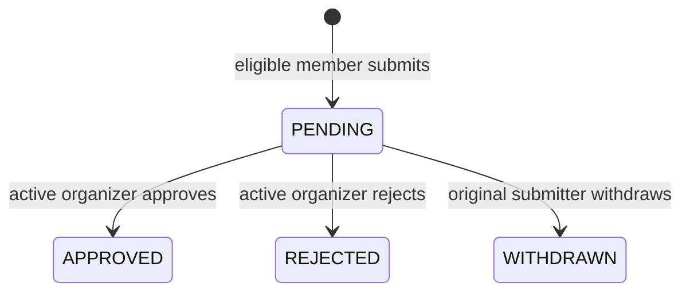

# V3 Task 4: Class Quiz Submission and Approval

**Owner:** Pronob

**Status:** Draft for team review

**Last updated:** November 1, 2026

## Purpose

Task 4 adds the approval step between publishing a quiz version and hosting that
version in a class. An active class member may submit an eligible immutable quiz
version, and an active organizer of that same class may approve or reject it.
Only an approved, current version should appear in the class's hostable quiz
list.

This document is a design draft. It does not add a migration, model, API route,
service, schema, or test.

## Dependency Status and Ownership

Task 4 depends on the final contracts from Tasks 1 through 3.

| Dependency | Interface Task 4 needs | Current blocker |
|---|---|---|
| Task 1: Admin semantics | Class access must require an active membership; only an active `ORGANIZER` may decide submissions. `ADMIN` must not bypass membership. | No V3 Task 1 branch or pull request is currently available. Existing `main` still contains global Admin bypasses. |
| Task 2: Class-scoped quizzes | `quiz.class_id`, class quiz endpoints, and migration `0008_quiz_class`. | PR #75 is approved but not merged. |
| Task 3: Sharing and locking | Final `QuizCollaborator` contract, collaborator eligibility, immutable version behavior, and migration `0009` after rebasing onto Task 2. | PR #74 is still a draft and currently overlaps Task 2, including its migration number. |

Task 4 should begin implementation only after those interfaces are stable. The
expected migration order is:

1. Task 2: `0008_quiz_class`
2. Task 3: `0009_quiz_collaboration`
3. Task 4: likely `0010_quiz_submission`

The final number must be checked against `main` immediately before creating the
migration.

## Proposed Data Model

Proposed table: `quiz_submission`

| Field | Proposed type and rule | Purpose |
|---|---|---|
| `submission_id` | Unsigned integer primary key | Identifies one submission attempt. |
| `class_id` | Required foreign key to `class.class_id` | Class receiving the submission. |
| `quiz_version_id` | Required foreign key to `quiz_version.quiz_version_id` | Immutable version being reviewed. |
| `submitted_by_id` | Required foreign key to `account.account_id` | Member who submitted the version. |
| `status` | Enum: `PENDING`, `APPROVED`, `REJECTED`, `WITHDRAWN` | Current review state. |
| `decided_by_id` | Nullable foreign key to `account.account_id` | Organizer who approved or rejected, or submitter who withdrew. |
| `submitted_at` | Required UTC timestamp | When the submission was created. |
| `decided_at` | Nullable UTC timestamp | When the pending state ended. |

Proposed invariants:

- The submitted version must be published and immutable.
- The version's quiz must belong to `class_id`.
- At submission time, the caller must be an active member of the class and
  either the quiz owner or an active, non-revoked collaborator.
- An active organizer may decide a submission only while the organizer remains
  active in that class.
- `decided_by_id` and `decided_at` are null while the status is `PENDING` and
  are set together when the status becomes terminal.
- Submission history is retained. Rejection and withdrawal never delete the
  database row.
- Only one active submission may exist for the same class and quiz version.
  The proposed meaning of active is `PENDING` or `APPROVED`.
- The duplicate rule must be concurrency-safe on MySQL. The exact database
  constraint or transaction strategy needs review because MySQL does not
  provide a normal partial unique index.

Foreign-key delete behavior should preserve the audit trail. The team should
confirm the project's account-retention policy before choosing `RESTRICT` or
`SET NULL` for actor references.

## Proposed State Machine



| Current status | Action | Actor | Result | Audit update |
|---|---|---|---|---|
| No submission | Submit eligible version | Active owner or collaborator | `PENDING` | Set `submitted_by_id` and `submitted_at`. |
| `PENDING` | Approve | Active class organizer | `APPROVED` | Set organizer as `decided_by_id` and set `decided_at`. |
| `PENDING` | Reject | Active class organizer | `REJECTED` | Set organizer as `decided_by_id` and set `decided_at`. |
| `PENDING` | Withdraw | Original submitter | `WITHDRAWN` | Set submitter as `decided_by_id` and set `decided_at`. |
| Terminal | Any transition | Any actor | Reject with `409` | Do not change the row. |

`APPROVED`, `REJECTED`, and `WITHDRAWN` are terminal for that submission row.
A new submission row may be created after rejection or withdrawal if the
version remains eligible.

## Draft API Contract

All endpoints require an active authenticated account. A missing class and a
class that the caller may not access must produce the same non-leaking
`404 class_not_found` response.

### Submit a quiz version

`POST /classes/{class_id}/quiz-submissions`

Proposed request:

```json
{
  "quiz_version_id": 321
}
```

Proposed result: `201 Created` with the submission response.

The service verifies class membership, quiz ownership or active collaboration,
class ownership of the quiz, publication of the version, and the absence of an
active duplicate in one transaction.

### List submissions

`GET /classes/{class_id}/quiz-submissions`

Proposed visibility:

- Active organizers see all submissions in the class.
- Other active members see only submissions they created.
- Being an unrelated `ADMIN` grants no visibility.
- Sorting and pagination are deferred to Task 6 unless the team moves that
  requirement into Task 4.

### Decide a submission

`PATCH /classes/{class_id}/quiz-submissions/{submission_id}`

Proposed request:

```json
{
  "status": "APPROVED"
}
```

The only accepted values are `APPROVED` and `REJECTED`. Only an active organizer
of this class may decide a pending submission. Approval must recheck that the
version is still published, belongs to the class, and is not stale.

### Withdraw a submission

`DELETE /classes/{class_id}/quiz-submissions/{submission_id}`

Proposed result: `204 No Content` after changing the status to `WITHDRAWN`.
This endpoint never physically deletes a row. Only the original submitter may
withdraw, and only while the status is `PENDING`.

### List approved quizzes

`GET /classes/{class_id}/approved-quizzes`

Active class members may retrieve approved, currently hostable immutable
versions. A proposed item includes:

- `submission_id`
- `quiz_id`
- `quiz_version_id`
- `version_number`
- `title`
- `author_id`
- `approved_at`
- `approved_by_id`

This response grants availability only. It does not grant edit access, class
management, hosting permission, report access, or results access.

## Proposed Submission Response

```json
{
  "submission_id": 42,
  "class_id": 7,
  "quiz_version_id": 321,
  "submitted_by_id": 18,
  "status": "PENDING",
  "decided_by_id": null,
  "submitted_at": "2026-11-01T15:30:00Z",
  "decided_at": null
}
```

## Authorization Matrix

| Caller | Submit eligible version | List submissions | Approve/reject | Withdraw own pending submission | View approved quizzes |
|---|---:|---|---:|---:|---:|
| Active quiz owner and class member | Yes | Own | Only if also organizer | Yes | Yes |
| Active collaborator and class member | Yes | Own | Only if also organizer | Yes | Yes |
| Active ordinary member without quiz access | No | Own, if any | No | Own only | Yes |
| Active organizer | Only when owner or collaborator | All in class | Yes | Own only | Yes |
| Invited, removed, or departed member | No | Hidden `404` | No | No | No |
| Unrelated `ADMIN` | No global bypass; hidden `404` | Hidden `404` | No | No | No |
| Outsider | Hidden `404` | Hidden `404` | Hidden `404` | Hidden `404` | Hidden `404` |

Revoked collaborators and removed class members lose submission eligibility
immediately. A pending submission from someone who later loses access remains
in the audit history; the team must confirm whether an organizer may still
approve it or must reject it.

## Proposed Errors

| HTTP status | Code | When returned |
|---:|---|---|
| `404` | `class_not_found` | Class does not exist or caller lacks active access. |
| `404` | `submission_not_found` | Submission does not exist in this class or is not visible to the caller. |
| `404` | `quiz_version_not_found` | Version does not exist, belongs to another class, or is not visible. |
| `403` | `not_submission_owner` | Active class member tries to withdraw another member's submission. |
| `403` | `not_class_organizer` | Active non-organizer attempts to approve or reject. |
| `409` | `quiz_version_not_published` | Version is mutable or unpublished. |
| `409` | `quiz_submission_conflict` | An active submission already exists for the class and version. |
| `409` | `invalid_submission_transition` | Requested action is not valid from the current status. |
| `409` | `quiz_version_stale` | Version is no longer the current publishable version. |

Error names are proposals and should be aligned with the final Task 2 and Task
3 error vocabulary before implementation.

## Stale-Version Proposal

A version becomes stale for new approval or hosting when the same quiz has a
newer published immutable version. Publishing the newer version does not delete
or rewrite the older submission. The older approval remains visible in audit
history but is excluded from `approved-quizzes`.

Creating or editing an unpublished draft does not immediately invalidate the
currently approved published version. The class keeps a hostable version until
a newer version is published. This interpretation needs team confirmation.

## Task 5 Integration Boundary

Task 4 should provide one reusable hostability query or service check that
answers whether a specific immutable version is currently approved for a
class. Task 5 will call that check when creating a live session.

Task 4 will not redesign session routes, join codes, WebSocket behavior,
question timing, scoring, reconnect behavior, or participant results. Those
remain Task 5 responsibilities.

## Acceptance-Test Matrix

### Submission eligibility

- Active quiz owner can submit a published version from the same class.
- Active collaborator can submit a published version from the same class.
- An ordinary member without access to the quiz cannot submit it.
- Invited, removed, departed, and unrelated accounts receive a non-leaking
  denial.
- An unrelated `ADMIN` receives no global bypass.
- A quiz version from another class cannot be submitted.
- An unpublished or mutable draft cannot be submitted.
- A revoked collaborator cannot submit.

### Decisions and withdrawal

- Active organizer can approve a pending submission.
- Active organizer can reject a pending submission.
- Active non-organizer cannot approve or reject.
- Organizer of another class cannot decide the submission.
- Original submitter can withdraw a pending submission.
- Another active member cannot withdraw it.
- Approved, rejected, and withdrawn rows reject further transitions.
- Decision actor and timestamp are stored together.
- A failed transition leaves every field unchanged.

### Duplicates and history

- A second pending submission for the same class and version is rejected.
- An approved version cannot receive another active submission.
- Rejected and withdrawn versions may be resubmitted under the proposed rule.
- Concurrent requests cannot create two active submissions.
- Historical rejected and withdrawn rows remain queryable by authorized users.

### Visibility and hostability

- Organizer sees all class submissions.
- Member sees only their own submissions.
- Active members see approved, current versions in `approved-quizzes`.
- Pending, rejected, withdrawn, cross-class, and stale versions are excluded.
- Approval does not grant editing access.
- Approval does not grant class-wide results or report access.
- Publishing a newer version requires a separate submission and approval.
- The previous approval remains in audit history after becoming stale.

### Database and regression coverage

- Forward migration succeeds on a disposable MySQL database whose name contains
  `test`.
- Rollback removes only Task 4 objects and succeeds on real MySQL.
- ORM metadata matches the migrated schema.
- Existing quiz versioning, collaboration, class authorization, reports, and
  live-quiz tests continue to pass.

## Decisions Required From the Team

The team should confirm these proposals before implementation:

1. `PENDING` and `APPROVED` both count as active for duplicate prevention.
2. `REJECTED` and `WITHDRAWN` versions may be submitted again.
3. `DELETE` means soft withdrawal by the original submitter, never hard delete.
4. A newer published version makes the older approved version stale; an
   unpublished draft does not.
5. A pending submission becomes unapprovable if its submitter later loses class
   membership or collaborator access.
6. Task 4 exposes the hostability check, while Task 5 integrates it with live
   session creation.
7. Sorting and pagination remain Task 6 work.
8. The MySQL mechanism used to enforce one active submission is safe under
   concurrent requests.

## Out of Scope

- Live-session creation or WebSocket changes
- Class dashboards and reports
- Frontend submission-management pages
- New app-wide Admin powers
- Editing, collaboration, or optimistic-locking changes
- Retrofitting legacy quizzes or sessions

## Review Checklist

- Task 1 removes global Admin bypasses before Task 4 uses the class helpers.
- Task 2 is merged with the final class-scoped quiz contract.
- Task 3 is rebased onto Task 2 and owns the next migration number.
- Endpoint payloads and error names match the final shared schemas.
- The stale-version and duplicate-submission proposals are approved.
- The implementation starts from a clean Task 4 feature branch or worktree.
