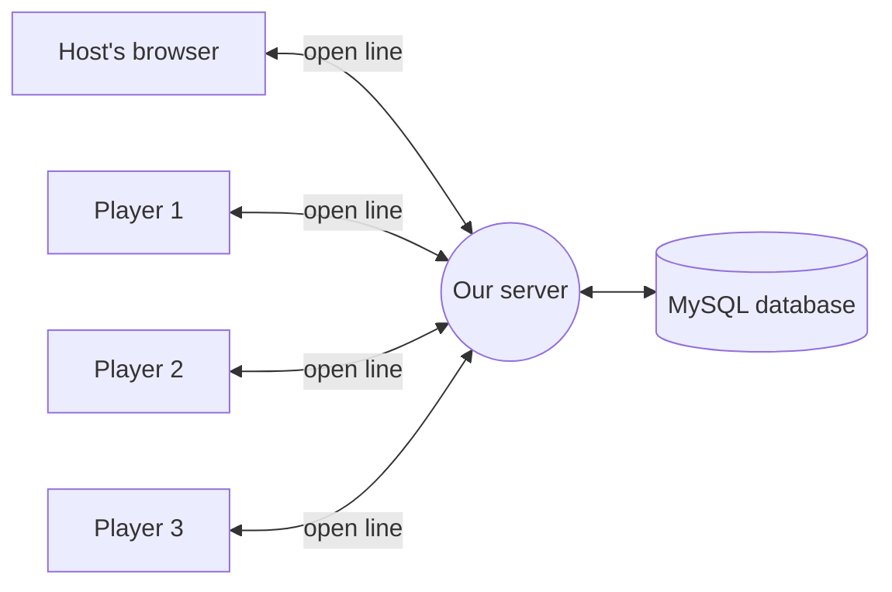

# WebSockets, explained

A beginner's guide to how live games work in our quiz app. You don't need to know anything about networking to read it. The exact rules (every message, every field, every error code) are in [LIVE_PROTOCOL.md](LIVE_PROTOCOL.md). This page explains the *why* and the *big picture*.

## 1. The problem: the server can't start a conversation

Most of our app works like **sending letters**. The browser asks a question ("give me my quizzes"), the server writes back, and the conversation is over. That's a normal web request (HTTP). It works great when *you* decide when to ask.

A live game is different. When the host clicks **Next question**, 30 players' screens need to change **right now**. With letters alone, the server has no way to reach the players first. Each player would have to keep asking "anything new? anything new? anything new?" every second. That is slow, wasteful, and still a little late.

## 2. The fix: a phone call that stays open

A **WebSocket** is like a **phone call** between a browser and the server:

- The browser "dials" once when you open the live game page.
- The line **stays open** for the whole game.
- **Either side can talk at any time.** The server can say "question 3 just started!" without waiting to be asked.

Every player and the host each have their own open line to the server. When something happens, the server talks into all of those lines at once. We call that a **broadcast**.



## 3. The golden rule: the database is the boss

> **Save it first, then announce it.**

The WebSocket only carries *news*. The database holds the *truth*. Every time something happens (a question opens, someone answers, the game ends), the server:

1. saves it to MySQL, and
2. only then tells everyone about it.

Why it matters: if a player's Wi-Fi drops and they come back, we don't need to replay everything they missed. We just look in the database and send them a fresh **snapshot**, a "here's where things stand right now" message. That's the same idea as rejoining a phone call and having someone say "okay, we're on question 4."

## 4. Walking through one game

### Step 1: Getting a code (normal web request, not WebSocket)
The host creates a session and gets a **6-digit join code**. Players type the code in to join. Both of those are ordinary web requests.

### Step 2: Dialing in
Each person's browser opens a line to:

```
/ws/sessions/<session id>
```

The **first thing** the browser must say, within 5 seconds, is "here's my login token." Think of it as saying your name and password when the call connects. Why not put it in the address? Addresses get written into server logs, and we don't want passwords lying around in logs.

The server checks:
- **Who are you?** It verifies the token, the same way the rest of the app does.
- **Do you belong here?** You must be this game's host, or a player who joined it. Anyone else gets hung up on.

If everything checks out, the server's **first message back is always the snapshot** (`session_state`), so your screen starts out correct.

### Step 3: The host opens a question
1. The host clicks **Next question**. Their browser says `open_question`.
2. The server saves "question 1 is open, closes at 12:00:20" to the database.
3. The server broadcasts `question_opened` to everyone, and every screen shows the question and a countdown.
4. The server sets an alarm for when time runs out.

### Step 4: Players answer
1. A player taps an answer. Their browser says `submit_answer`.
2. The server saves the answer and works out the score, but **doesn't reveal it yet**, so nobody can peek at who's right.
3. The player gets a private "got it ✓" reply (`ack`).
4. The host gets a progress update: "12 of 30 answered."

### Step 5: The question closes
A question can close **three ways**:
- everyone answered,
- the timer ran out, or
- the host clicked **Skip**.

These could happen at nearly the same instant. Picture the last player answering just as the timer hits zero. We must not announce "question closed" twice. So all three paths go through **one** database step that says "close this question, but only if it's still open." Only **one** of them can win that race, and only the winner makes the announcement. It's like several people grabbing for the same light switch: only the first flip counts.

Then everyone gets the results:
- the **host** sees every player's answer and score;
- each **player** sees only their own result and the **top 5** leaderboard.

### Step 6: Repeat, then the game ends
The host keeps opening questions. At the end they click **End** (or **Cancel** if the game never started). The server saves final scores, broadcasts `session_ended`, and hangs up politely on everyone. Each screen shows the final results.

## 5. When things go wrong

Real life is messy, and most of the code handles these cases:

| What happens | What the app does |
|---|---|
| A player's Wi-Fi drops | Their browser redials automatically, waiting a bit longer each time (1 s, 2 s, 4 s … up to 30 s). They get a fresh snapshot and carry on. They are **still in the game** the whole time, and the question doesn't close early without them. |
| The player refreshes the page | Same as above. If they already answered, the snapshot says so, and they see "answer submitted" instead of the choices again. |
| The host's Wi-Fi drops | The game keeps going. Timers still run on the server. Players see "waiting for host." When the host comes back, they pick up where they left off. |
| The host never comes back | *(Coming in PR #53.)* After 15 minutes with no host, the server ends the game by itself. |
| Same person opens the game in two tabs | The newest tab wins. The old one shows "opened in another tab." |
| The line goes quiet | Browsers send a tiny "ping" every 25 seconds and the server replies "pong," like saying "you still there?" on a call. If the server hears nothing for 60 seconds, it hangs up, and the browser simply redials. |
| Someone sends nonsense | The server checks every message against a strict list of allowed shapes. Players only ever send IDs ("I picked choice 42"), never scores or times, so nobody can cheat by sending "I got 1,000,000 points." |

When the server hangs up, it gives a **reason number** (a "close code") so the browser knows what to do next. Examples: "game over" means show results; "not allowed" means go to the dashboard. The full list is in [LIVE_PROTOCOL.md §7](LIVE_PROTOCOL.md#7-errors-and-close-codes).

## 6. Who does what in the code

### Server (Python, `backend/app/`)

| File | Plain-English job |
|---|---|
| `api/routes/live.py` | **The receptionist.** It answers each new line, checks the login, then listens for messages and passes each one to the right place. |
| `live/hub.py` | **The switchboard.** It remembers who is connected to which game, sends broadcasts, runs the question timers, and makes sure each new caller gets their snapshot before anything else. |
| `live/snapshot.py` | **The "where are we now?" writer.** It builds the snapshot from the database, and trims results down so players only see what they're allowed to see. |
| `live/protocol.py` | **The rulebook.** It lists every allowed message shape and every close code. |
| `live/auth.py` | **The ID check** for the first message. |
| `services/…` | **The actual game logic** (open question, save answer, score, end game). The same code is used whether a request comes over the WebSocket or a normal web request. |

### Browser (JavaScript, `frontend/src/live/`)

| File | Plain-English job |
|---|---|
| `liveClient.js` | **The phone.** It dials, sends the login first, pings every 25 s, redials after a drop, and matches each reply to the button press that caused it. |
| `liveReducer.js` | **The scoreboard keeper.** Each incoming message updates one tidy "current state of the game" object. |
| `liveSession.js` | Glues the phone and the scoreboard together and adds the buttons: next, skip, end, answer, leave. |
| `useLiveSession.js` | Hands all of that to a React page in one line: `const live = useLiveSession(sessionId)`. |
| `authenticated-demo/LiveSessionPage.jsx` | The live game screen itself. |

## 7. One limitation to know about

The switchboard (`hub.py`) keeps its list of open lines **in the server's memory**. That means we must run **one copy** of the backend server. If we ran two copies, a player connected to copy A wouldn't hear announcements made by copy B. Big apps solve this with a shared messaging service such as Redis. For a class-sized app, one server is plenty, so we skipped that on purpose.

## 8. Mini glossary

- **WebSocket**: a connection that stays open so both sides can talk anytime (the "phone call").
- **HTTP request**: a one-off question and answer (the "letter").
- **Broadcast**: sending the same message to everyone in a game.
- **Snapshot (`session_state`)**: a full "here's where things are" message, sent whenever someone connects or reconnects.
- **Ack**: a private "got it" reply to something you sent.
- **Token**: proof of who you are, from our login system (Auth0).
- **Close code**: the reason number given when a line is hung up.
- **Session**: one play-through of a quiz (lobby, then questions, then results).
