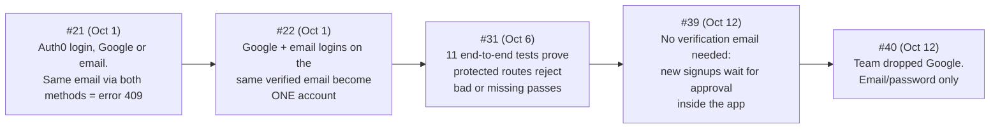
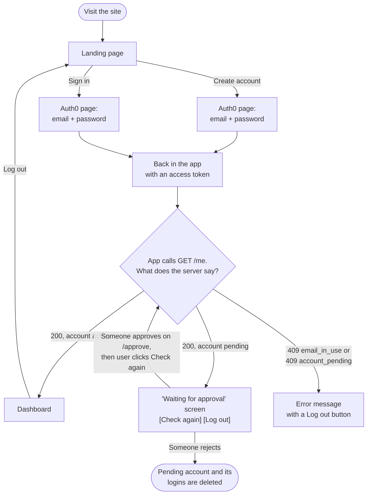
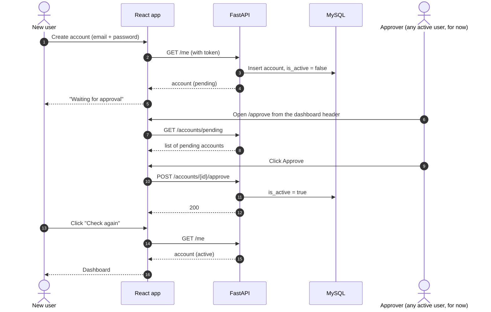
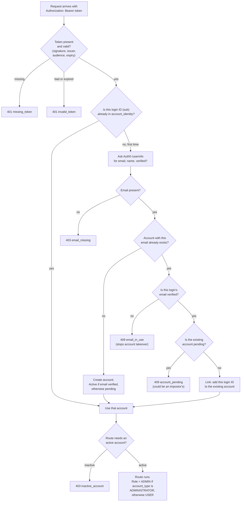
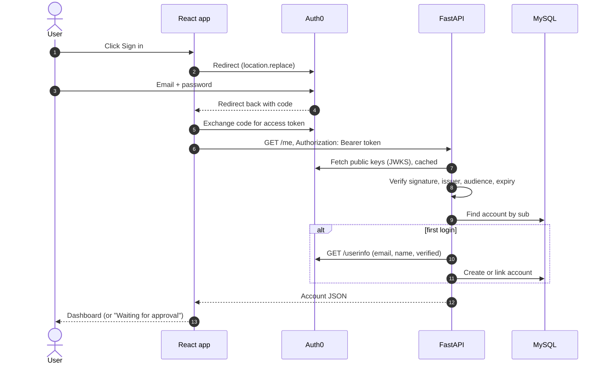
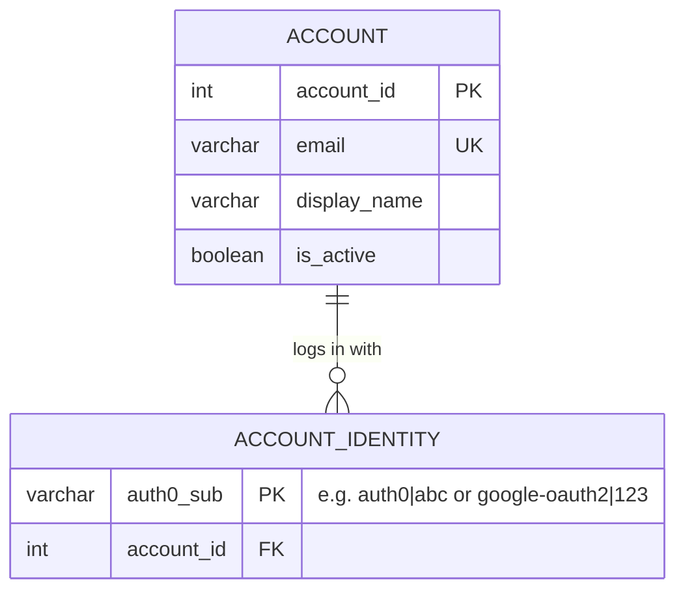

# Authentication and accounts

**PRs:** [#21](https://github.com/sudo-nickPinto/CS440-Quiz-Platform/pull/21) · [#22](https://github.com/sudo-nickPinto/CS440-Quiz-Platform/pull/22) · [#31](https://github.com/sudo-nickPinto/CS440-Quiz-Platform/pull/31) · [#39](https://github.com/sudo-nickPinto/CS440-Quiz-Platform/pull/39) · [#40](https://github.com/sudo-nickPinto/CS440-Quiz-Platform/pull/40)
**Course weeks:** 6–8 (Sep 28 – Oct 12, 2026)
**Assigned at:** the 2026-09-27 meeting ("Integrate Auth0 on the frontend: login button, redirect/callback, logout, protected routes, access token on API requests, unauthorized and error states")

## In plain terms

Professor Kim asked for "some kind of login" so student results stay private. Nick built that login. A person clicks **Sign in** or **Create account**, types their email and password on Auth0's secure login page, and comes back to the app signed in. Every time the app asks the server for something, it shows a digital pass (an *access token*). The server checks the pass is genuine and not expired, then looks up or creates that person's account in our MySQL database.

Over three weeks the login changed as the team made decisions:

## What exists after PR #40

| Layer | File | Job |
|---|---|---|
| Frontend | `frontend/src/main.jsx`, `App.jsx` | Wrap the app in the Auth0 provider, restore the session after a reload |
| Frontend | `frontend/src/components/AccountGate.jsx` | After login, call `GET /me` so the account exists before the dashboard shows. Shows "Waiting for approval" for pending accounts |
| Frontend | `frontend/src/api.js` | Attach the access token to every request, show the backend's error message, handle `204 No Content` |
| Frontend | `frontend/src/components/ApproveUsersPage.jsx` | The `/approve` page: list pending signups, approve or reject them |
| Backend | `backend/app/auth.py` | `current_user`: verify the RS256 token against Auth0's public keys (signature, issuer, audience, expiry) |
| Backend | `backend/app/accounts.py` | `get_or_create_account`: find the account by login ID, or link/create it on first login |
| Backend | `backend/app/api/routes/me.py` | `GET /me`, and the `current_account` dependency every protected route uses |
| Backend | `backend/app/api/routes/approvals.py` | `GET /accounts/pending`, `POST /accounts/{id}/approve`, `DELETE /accounts/{id}` |
| Database | `ulugbek-err/migrations/0004_account_identity.*.sql` | A table mapping each Auth0 login ID (`sub`) to one account |
| Docs | `docs/AUTH.md` | Login sequence, request flow, decision flow, setup and error codes |
| Tests | `backend/tests/test_accounts.py`, `backend/tests/test_auth.py` | Token checks, account creation, linking, approval rules, protected-route chain |

## User flow: signing up and getting in

This is what a new user sees after PR #39 and #40.

## User flow: approving a new signup

Before PR #39, an email/password signup was blocked with "Please verify your email", because the team has no email sender set up in Auth0. Rather than set one up, Nick moved approval into the app.

> **Testing-only access:** for now *any* active user can approve or reject. Before release, `approvals.py` should require `account.is_admin`, and the page should move into the admin area. Pending users are already blocked from quizzes, sessions and answers by the existing `get_active_account` check (403).

## How the server decides who you are

Every protected request goes through the same chain. This is the logic in `accounts.py` after PR #39.

Two safety rules are worth calling out:

- **An unverified email never joins an existing account.** Otherwise someone could sign up with a classmate's email and take over that classmate's account.
- **A verified login never joins a pending account.** The pending account might have been made by an impostor using that email.

If two "first" requests for the same person arrive at the same moment, the database's uniqueness rules reject one of them, and the code retries the lookup instead of failing (`IntegrityError` handling in `get_or_create_account`).

## The login sequence (from `docs/AUTH.md`)

Small details Nick handled along the way:

- **`location.replace` for login redirects**, so the browser's Back button doesn't bounce users into Auth0's one-time pages.
- **Dev-only session cache.** On `localhost`, Auth0 always asks for consent, so the silent re-login after a page refresh can never succeed. In development only, the session is cached in `localStorage`. Production keeps tokens in memory.
- **No account types in the MVP.** Everyone is a host and a participant. `account_type` stays empty until the team decides how Professor/Admin status is assigned (the MVP has User and Admin only).

## PR-by-PR

### #21 — Add Auth0 login, token verification and accounts (Week 6, Oct 1)

The first working login. Frontend: Auth0 signup, login, Google, logout and session restore. Backend: `auth.py` checks tokens, `accounts.py` creates the account on first login, `GET /me` returns it. Also wrote `docs/AUTH.md` with four diagrams and setup steps.

- **Known limit:** Google and email/password on the same email gave two different Auth0 IDs, so the second login got `409 email_already_registered`.
- **Tests:** 11 new (missing, garbage, wrong-audience, wrong-issuer, expired and wrong-key tokens; Auth0 not configured; first and repeat login; unverified email; duplicate email). 15 passing in total.

### #22 — Link Google and email/password logins to one account (Week 6, Oct 1)

Fixed the 409 above. Added migration `0004_account_identity`: a table where each Auth0 login ID points at one account. Existing IDs were copied in. The migration was tested up, down and up again on local MySQL. A new login whose **verified** email matches an existing account is linked to it. Forgot-password needed no code, because Auth0's page provides it. 17 tests passing.

### #31 — Add end-to-end tests for protected-route auth (Week 7, Oct 6)

After Anh's quiz API landed (#26), its tests replaced the login check with a fake, so nothing tested the real chain *token → account → role* that protected routes use. Nick added 11 tests against `GET /quizzes` with real signed tokens:

| Situation | Expected |
|---|---|
| No token | 401 `missing_token` |
| Malformed token | 401 `invalid_token` |
| Expired token | 401 |
| Valid token, first login | 200, USER account created |
| Inactive account | 403 `inactive_account` |
| `account_type = ADMINISTRATOR` | role `ADMIN` |
| Any other `account_type` | role `USER` |

39 tests passed. The last test pins down the MVP's User/Admin model, so it will need updating if Professor/Student roles are added later.

### #39 — Approve email/password signups in the app (Week 8, Oct 12)

Covered in the flows above. Backend changes: unverified signups become *pending* instead of 403, new linking rules (`email_in_use`, `account_pending`), and a new `approvals.py` route file. Frontend: the "Waiting for approval" screen, the `/approve` page styled with the dashboard's design classes, and a link from the dashboard header. No migration: it reuses `account.is_active`. 157 backend tests passed, and a manual API smoke test covered nine cases (verified active, unverified pending, pending blocked, duplicate 409, verified-into-pending 409, approve, re-approve 404, reject pending 204, reject active 404).

### #40 — Remove Google sign-in (Week 8, Oct 12)

The group decided to drop Google. Nick removed the "Continue with Google" button from the landing page and told Auth0 to show only the email/password connection (`Username-Password-Authentication`). The PR also deleted the unused old `LoginPage.jsx` and `LoginPage.css` (−599 lines) and updated the README, `docs/AUTH.md`, `docs/ROADMAP.md` and a code comment.

**Kept on purpose:** the account-linking table, because accounts created with Google before the change still need it. Applied migrations were not edited, and Taha's design reference files were left for Taha.

**Still to do outside the repo:** someone with Auth0 access must turn off the Google connection for the app in the Auth0 dashboard.
