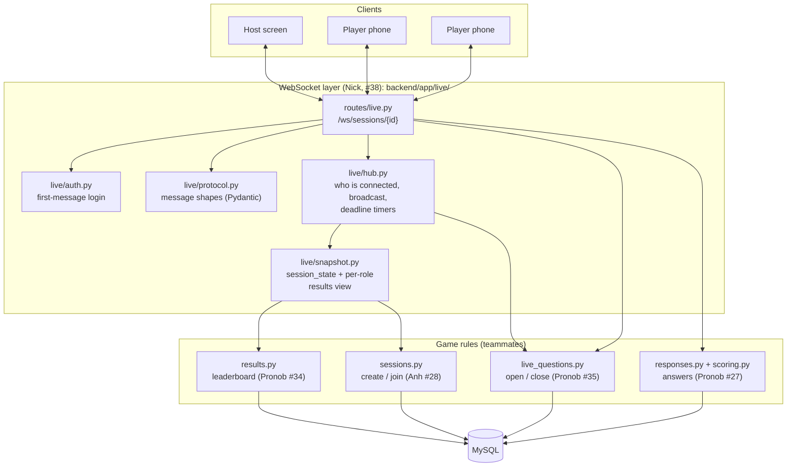
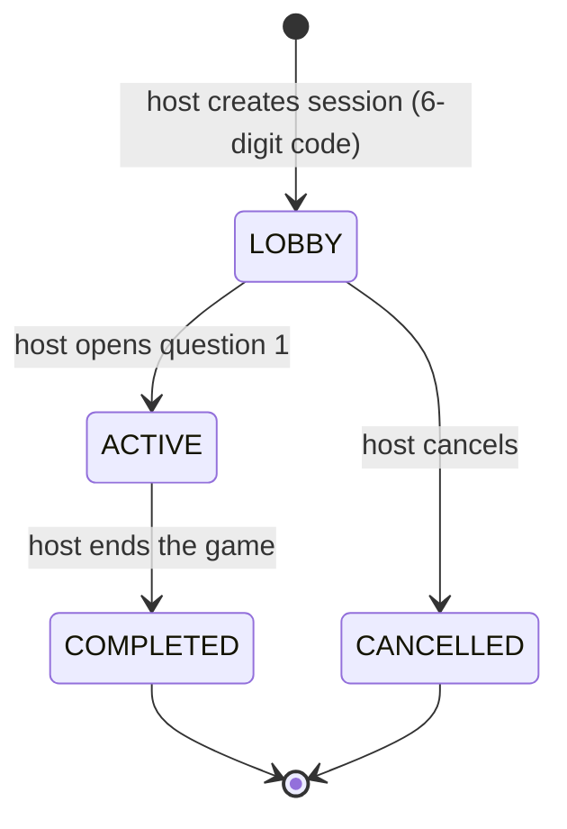
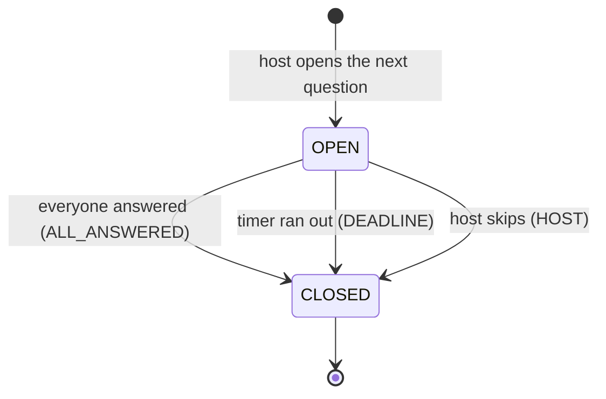
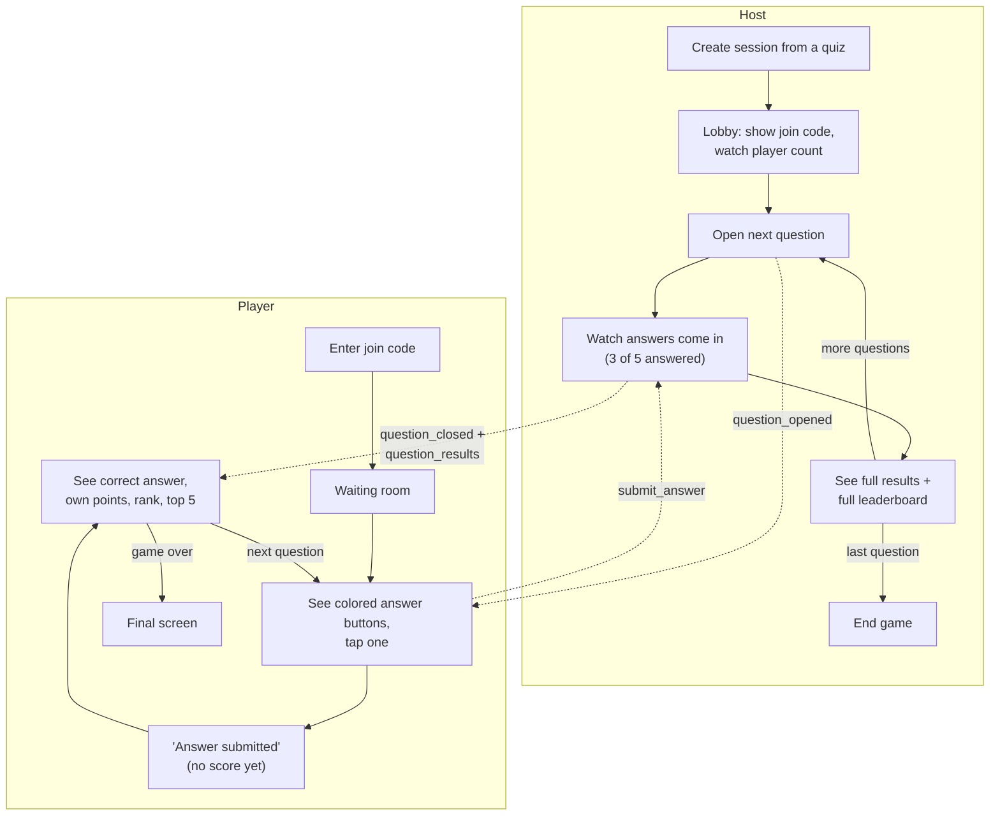
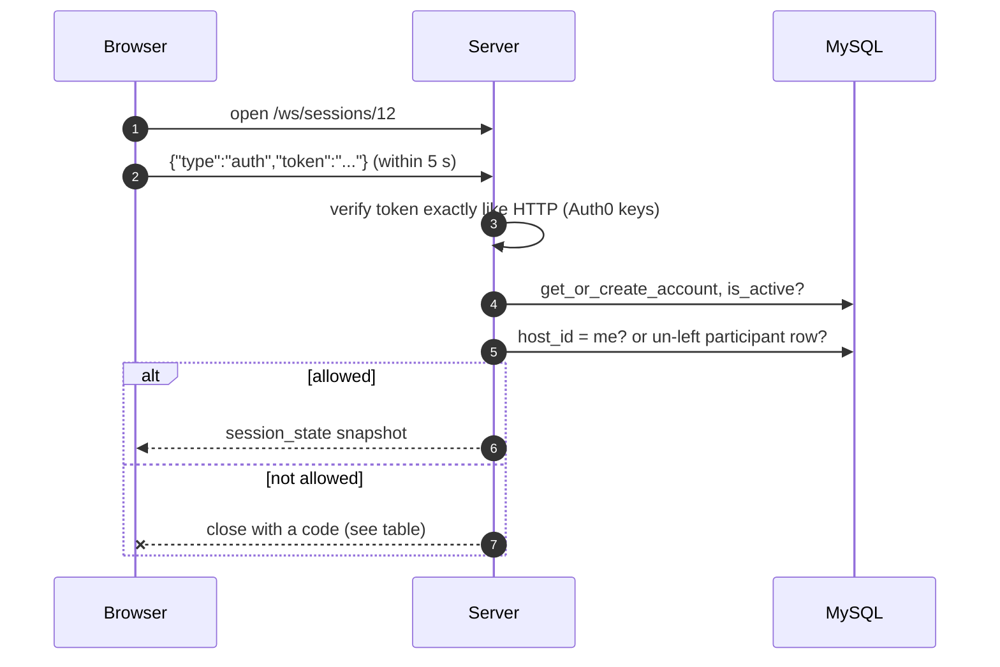
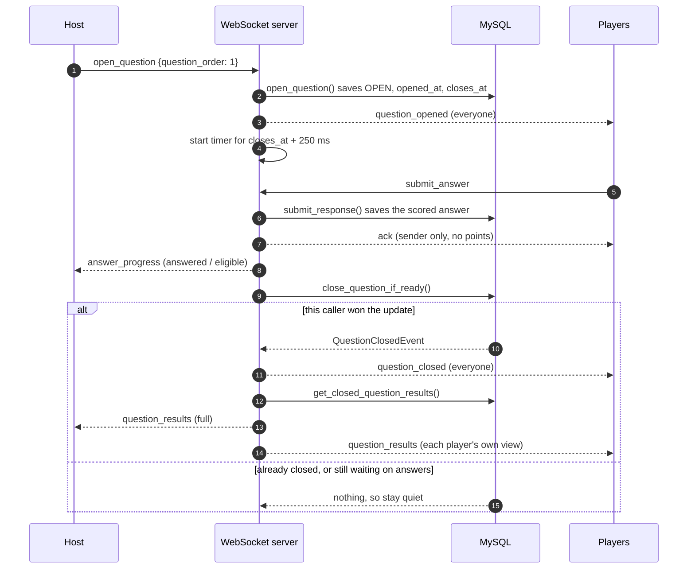
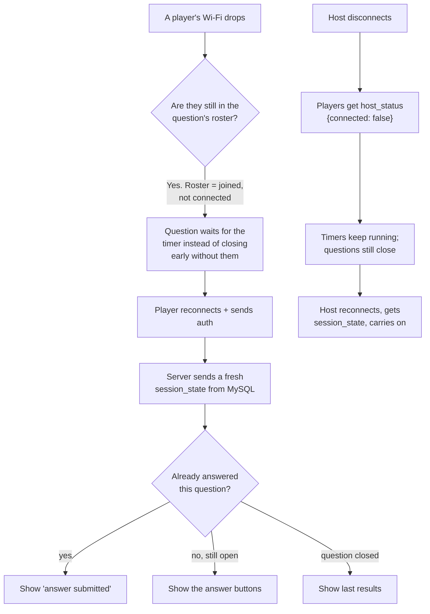
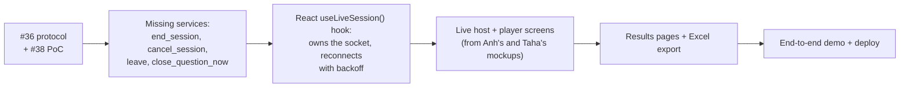

# Live sessions: the protocol and the WebSocket proof of concept

**PRs:** [#36](https://github.com/sudo-nickPinto/CS440-Quiz-Platform/pull/36) (protocol doc) · [#38](https://github.com/sudo-nickPinto/CS440-Quiz-Platform/pull/38) (WebSocket PoC)
**Course week:** 8 (Oct 12, 2026)
**Roadmap owner:** Nick was the proposed owner of the protocol doc, the WebSocket PoC, the live controls and reconnect handling (`docs/ROADMAP.md`).

## In plain terms

Most of the app works like a normal website: the browser asks, the server answers. A live quiz game doesn't fit that. When the host starts question 3, every player's phone has to switch to question 3 **at the same moment**, without anyone refreshing.

A **WebSocket** is a phone line that stays open between each browser and the server, so the server can push news ("question 3 is open", "time's up", "here's the leaderboard") the instant it happens.

By Week 8, teammates had already built the game's *rules* as backend services: creating and joining a session (Anh, #28), scoring answers (Pronob, #27), opening and closing questions (Pronob, #35), and the leaderboard (Pronob, #34). Nothing connected those rules to players in real time yet. Nick's two PRs are that connection:

1. **#36, the rulebook.** It defines exactly which messages the host screen, player screens and server send each other, and what each one means. Front-end and back-end developers can build against it independently.
2. **#38, the working prototype.** A real server endpoint where a host and players can actually play questions live, tested end to end with one host and two players.

**The one rule behind everything:** the database is the source of truth, and the WebSocket only carries news about it. The server always saves to MySQL first, then tells everyone. A player who reconnects gets a fresh snapshot from the database rather than a replay of what they missed.

## How the pieces fit

## The states a game goes through

**A session** (one play-through of a quiz):

**A question** inside a session:

Questions open strictly in order, one at a time, and a closed question never reopens. The server sets the timer; the phone's clock is only used to draw the countdown.

## User flow: playing a live game

Players never see whether they were right until the question closes (a rule from Pronob's #27). After it closes, a player sees only their own row plus the top 5. The host sees everyone.

## Connecting securely

Browsers can't attach a login header to a WebSocket, and putting the token in the URL would leak it into server logs. So the protocol makes the **first message** the login:

| Close code | Meaning | What the screen should do |
|---|---|---|
| `1000` | Session ended normally | Show the final screen |
| `4400` | Malformed message, or the first message wasn't `auth` | Bug: log it |
| `4401` | Missing, invalid or expired token, or took longer than 5 s | Get a new token, reconnect once, then go to login |
| `4403` | Not the host or a participant, or account inactive | Go to the dashboard |
| `4404` | Session not found | Go to the dashboard |
| `4409` | Same account opened the game in another tab | Show "opened in another tab" |
| `4410` | Session already completed or cancelled | Show the final screen |
| `1011` | Server error | Reconnect with backoff (1 s, 2 s, 4 s … max 30 s) |

## Closing a question exactly once

This was the trickiest part. Three things can end a question: the **last player answering**, the **timer running out**, and the **host skipping**. These can happen at almost the same instant. If two of them both announced "time's up", every phone would get the results twice.

The fix: all three paths call Pronob's `close_question_if_ready()`, which flips the question from `OPEN` to `CLOSED` with a single database update that only one caller can win. **Only the winner broadcasts.**

If the server restarts, in-memory timers are lost. To cover that, a sweep closes any overdue `OPEN` question at startup and on each connect.

## Disconnects and reconnects

## What each message is

| Direction | Message | Meaning |
|---|---|---|
| any → server | `auth` | First message: "here's my login" |
| any → server | `ping` | "Still here" (every 25 s); server answers `pong` |
| host → server | `open_question` | Start the next question |
| player → server | `submit_answer` | "I picked choice 42" |
| server → one | `session_state` | Full snapshot on every connect and reconnect |
| server → all | `question_opened` | Show the question and start the countdown |
| server → host | `answer_progress` | "3 of 5 have answered" |
| server → all | `question_closed` | Time's up, with the reason |
| server → each | `question_results` | Host: everything. Player: own row + top 5 |
| server → players | `host_status` | Host connected or not |
| server → sender | `ack` / `error` | Reply to a command; errors use the same codes as the HTTP API and keep the socket open |

Planned but not in the PoC: `close_question` (host skip), `end_session`, `cancel_session`, `leave`, `participant_joined`/`participant_left` and `session_ended`. In #38 the commands answer `error: command_not_supported`.

## PR #36 — the protocol (`docs/LIVE_PROTOCOL.md`)

A docs-only PR that defines the contract above, built on top of the four merged teammate services. It covers state machines, first-message authentication, every event in both directions (reusing the existing Pydantic models and HTTP error codes), reconnect snapshots, the exactly-once close rule, host vs. player result views (the results service has no permission check of its own, so the WebSocket layer filters), close codes, implementation rules, and open questions for the next meeting:

1. Should players see top 5 + their own rank, or only their own rank? (Taha, depending on the approved screens)
2. Should abandoned sessions auto-cancel? (Proposed: not in the MVP.)
3. Should Admins be able to watch live? (Proposed: no; they see results afterwards.)
4. Can a host also play? (No; the schema already forbids it.)

**Reviewers requested:** Pronob (lifecycle/results fit), Anh (sessions/MySQL), Taha (participant view and leaderboard vs. screens).

## PR #38 — the WebSocket proof of concept

The first step of the protocol's build plan. New code lives in `backend/app/live/` (`protocol.py`, `auth.py`, `snapshot.py`, `hub.py`) and `backend/app/api/routes/live.py`.

**Design rules it follows:**

- One database session per command, run in the threadpool, closed straight after. A row lock held by a long-lived session could block everyone.
- Commit, then broadcast.
- An in-memory registry of who is connected, so the MVP runs **one uvicorn worker**. More workers would need Redis, which is out of scope.
- The REST answer route (`POST /sessions/{id}/questions/{qid}/responses`) runs the same after-answer hook as a background task, so it can't become a back door that never closes questions.

**Verification:**

- The existing suite passed: **157 tests** against MySQL.
- A manual end-to-end script (not committed) ran a real server with a host and two player clients against MySQL: **29 of 29 checks passed**. It covered every refusal code, the 4409 tab replacement, both roles' snapshots, a duplicate answer being rejected, `answer_progress` 1/2, exactly one `question_closed` per socket arriving before results, the player-view filter, reconnecting to `last_results`, host disconnect and reconnect, a deadline close at ~2.3 s on a 2 s question, a REST answer triggering the close broadcast, and a malformed message closing with 4400.

**Not included:** automated WebSocket tests (a team decision for now; the protocol's §8.5 asks for one), the not-yet-written services (`end_session`, `cancel_session`, `leave`, host force-close), and join/leave broadcasts (joining is still REST-only).

## What this unlocks next

