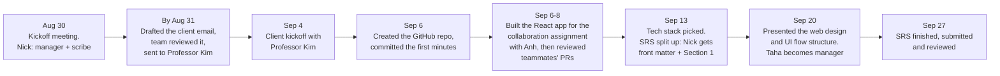
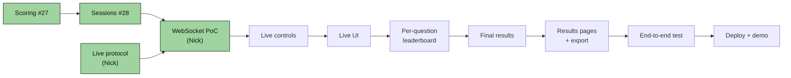
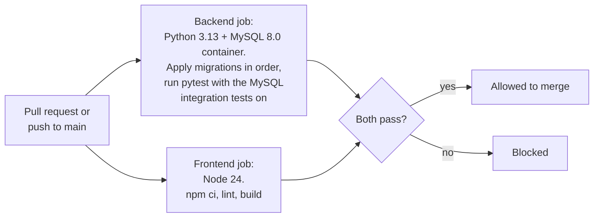

# Planning, process and maintenance

**PRs:** [#23](https://github.com/sudo-nickPinto/CS440-Quiz-Platform/pull/23) (roadmap) · [#32](https://github.com/sudo-nickPinto/CS440-Quiz-Platform/pull/32) (npm security fix) · [#37](https://github.com/sudo-nickPinto/CS440-Quiz-Platform/pull/37) (CI, closed)
**Plus:** project management, client outreach, repository setup, meeting minutes and the SRS (Weeks 1–5)

Not all of Nick's contributions are code. This page covers the work that kept the project organized and moving.

## Weeks 1–4: first team manager

At the kickoff meeting on **Sunday, Aug 30**, Nick was named team manager for the first three-week phase (through **Sep 20**) and took the minutes. On Sep 20, Taha took over as manager.

**What the manager did, by the minutes:**

- **Client outreach.** Drafted the first email to Professor Kim, posted it in the team chat for review, and sent it the Monday after the kickoff. It introduced the team, asked for kickoff availability, and listed the team's clarifying questions: how should it work and look, what counts as success, Moodle integration, where student data lives, why not an existing tool, and what the signature feature should be.
- **Requirements-first approach.** The team agreed to let Professor Kim describe her vision before proposing features. That paid off. The client meeting showed that Moodle wasn't needed, that a MySQL database on the CS server was available, and that the real problem was collecting and reviewing results, which Kahoot made confusing.
- **Tooling.** Set up the GitHub repository and collected everyone's GitHub usernames.
- **Process decisions** made under Nick's management: weekly Sunday meetings, a rotating scribe, Microsoft Teams for communication, GitHub for issues and pull requests, and every member reviewing PRs.

## Meeting minutes

| Commit | Date | What |
|---|---|---|
| `7f5107c`, `3f7ccbd` | Sep 6 | Initial commit, and the `meeting_minutes/` folder with the Aug 30 minutes (Nick was scribe) |
| `514efb4` | Sep 28 | Uploaded the Sep 13 (team and client), Sep 20 and Sep 27 minutes that teammates wrote |

## Requirements and design (Weeks 3–5)

- **SRS:** wrote the front matter and Section 1, then finished and submitted the combined SRS (due the Sunday after the Sep 20 meeting) and reviewed it.
- **Design structure:** at the Sep 20 meeting, presented the web design structure and UI flow architecture. The team then finalized wireframes and the component hierarchy from it.

## PR #23 — MVP roadmap (`docs/ROADMAP.md`)

*Opened Oct 1 (Week 6), updated to the Oct 4 MVP scope, merged Oct 12 (Week 8).*

**In plain terms:** a single page that says where the project is, what's left, who owns it, and what has to happen first for the final demo (around Dec 11) to stay on schedule.

What it contains:

1. **Status table** of `main` and the open PRs, with owners.
2. **Gantt chart** from Sprint 0 (done) through Sprint 5, using two-week sprints, with Thanksgiving week left empty as a buffer.
3. **Critical-path flowchart:** the chain where any slip delays the demo.
4. **Per-sprint task tables** with an owner and a concrete "done when" for each task (a merged PR, a doc, a passing test or a demo).
5. **"After the MVP"** list: Professor/Student roles, classes, private quizzes, editing saved quizzes, statistics and the admin dashboard. These were deliberately kept off the timeline.

The roadmap's critical path, simplified:

*Green = done by PR #40* (scoring #27, sessions #28, protocol #36, WebSocket PoC #38).

The roadmap made the biggest risk visible: on Oct 6 the live-session layer was "not started" and sat on the critical path. Nick took it on and delivered the protocol and the PoC by Oct 12 (see [02-live-sessions.md](02-live-sessions.md)).

It also recorded the team's mid-semester scope cut on **Oct 4**: the MVP has **User and Admin** roles only, and "host" and "participant" are things a User does rather than roles.

## PR #32 — Fix npm audit warning (Week 7 → 8)

**In plain terms:** a tool that the frontend build depends on had a known security bug. Nick updated it.

- `npm install` reported **1 high-severity vulnerability** in `source-map-js` 1.2.1 ([GHSA-68fv-2mgg-jv7q](https://github.com/advisories/GHSA-68fv-2mgg-jv7q)): a crafted source map could freeze the build tool.
- The fix only bumped it to 1.2.2 in `frontend/package-lock.json`. It's a build-time tool pulled in by Vite, so nothing users download changed.
- Checked: `npm audit` reported 0 vulnerabilities, and lint and build passed.
- Assigned to Taha for review, since Taha owns the frontend design and its dependencies.

## PR #37 — CI workflow *(closed, not merged)*

**In plain terms:** a robot that would run every test and build on every pull request, so broken code couldn't be merged by accident.

It proposed `.github/workflows/ci.yml` with two jobs:

No secrets were needed, because the database is a throwaway container and tests replace Auth0 with a fake. Nick **closed** the PR a minute after opening it on Oct 12 ("not adding CI/tests right now"), so CI isn't part of the repository. The kickoff minutes had listed GitHub Actions as a goal, so this remains an option if the team changes its mind.

## Code review and coordination

- Wrote `docs/AUTH.md` notes on how to merge Anh's stacked quiz PRs (#13–#20) on top of the auth work (`05fe383`, Oct 1).
- Requested specific reviewers on each PR based on who owned the code it touched. For example, #36 asked Pronob about lifecycle/results fit, Anh about sessions/MySQL, and Taha about the participant view.
- Every PR description includes what changed, what was deliberately left out, and how it was verified. Most also include a "still to do" list for follow-up work outside the repo.
