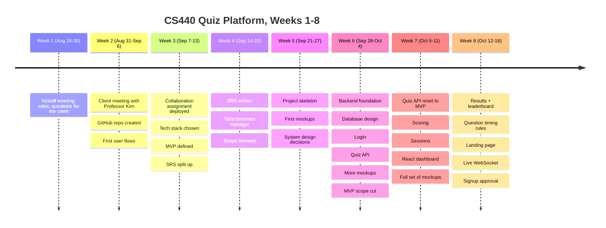
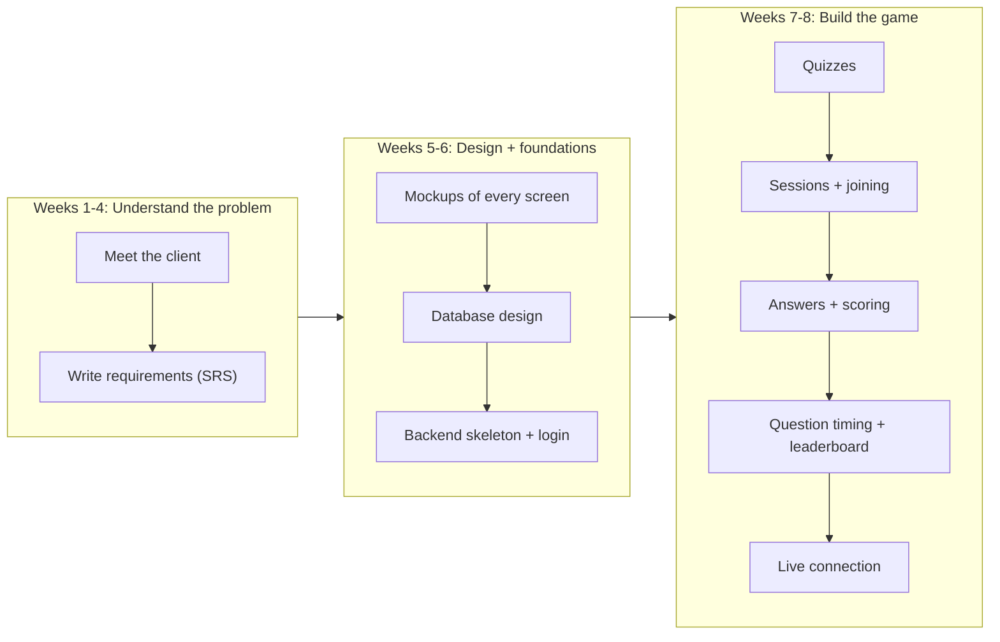
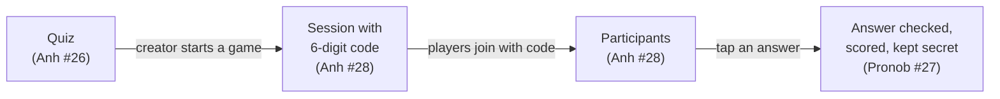
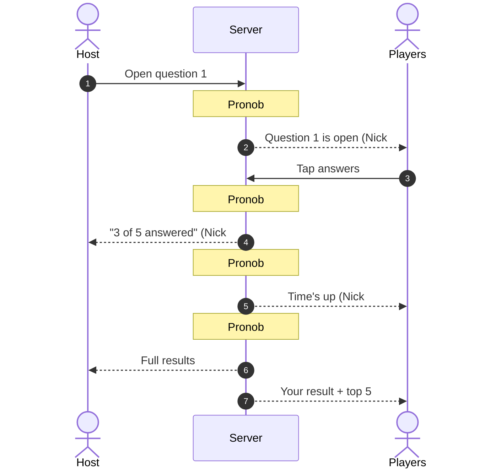

# Team timeline, week by week

A plain-language account of what everyone on the team contributed from the start of the course through PR #40. Nick's own work is summarized briefly in each week, with links to the detailed pages.

**The team:** Nick Pinto, Hoang Phuong Anh Nguyen (Anh), Taha Sabir, Anindo Majumder, Pronob Sarker, Ulugbek Khairulla (Ulug).
**Client:** Professor Kim. **Course instructor:** Professor Ilinkin.

**How weeks are counted:** Monday to Sunday, with Week 1 ending at the first team meeting on Sunday, Aug 30, 2026. Dates are Eastern time. Numbers #1–#3 and #9 are GitHub issues, not PRs, and #15 and #29 don't appear in the repo. #41 falls after the cutoff.

## Quick glossary

| Term | Meaning |
|---|---|
| **PR (pull request)** | A proposed change to the code that teammates review before it's added ("merged") |
| **Frontend** | What runs in the browser: the screens people see (React) |
| **Backend** | The server that stores data and enforces the rules (FastAPI, in Python) |
| **Database** | Where everything is saved permanently (MySQL on the CS server) |
| **Mockup** | A clickable picture of a screen with fake data, used to agree on the design before building it |
| **Endpoint / API** | A specific request the frontend can make to the backend, like "list my quizzes" |
| **Migration** | A script that creates or changes database tables in a repeatable way |
| **MVP** | Minimum viable product: the smallest version that does the whole job end to end |

## The whole semester so far

---

## Week 1 — Aug 24 to Aug 30: Kickoff

**The team met for the first time** (Sunday, Aug 30) to do introductions, pick roles, and plan how to approach the client.

- **Everyone:** agreed the project was "something like Kahoot or Quizlet", with ideas such as tracking results across a whole semester, team support, and grade upload. Crucially, they agreed to treat these as questions for the client, not as decisions.
- **Process set up:** weekly Sunday meetings, Microsoft Teams for chat, GitHub for code, a rotating note-taker, and everyone reviewing each other's code.
- **Nick:** chosen as the first team manager (through Sep 20), took the minutes, and was tasked with emailing the client and creating the GitHub repo. → [details](03-planning-process-and-maintenance.md)

## Week 2 — Aug 31 to Sep 6: Meeting the client

**The team met Professor Kim on Friday, Sep 4** and learned what was actually needed.

What the client said, in short:

- Kahoot made results hard to collect: groups had to send in questions, answers and scores separately, and it got confusing. **The main need is easy access to results**, mainly how many questions each student got right, per day and in total, ideally as an Excel-style file.
- It should be **phone-first** but work on laptops, have Kahoot-style **colored answer buttons**, speed-based scoring with a podium, feedback after each question, and a review at the end.
- Students' results must be **private and behind a login**. The instructor needs admin access.
- **Moodle integration isn't needed.** A MySQL database on the CS server is available.
- She wants to **use it next semester instead of Kahoot**, and asked for readable code.

Other work this week:

- **Anindo:** created the `notes/` folder and wrote down the first **user flows**: what a player does (log in, enter a code, play, see results) and what a presenter does (create a quiz, start a session, run questions, show the leaderboard, check results later). Anindo was also the scribe for the Sep 6 meeting.
- **Nick:** sent the client email, created the GitHub repository, committed the first minutes, and with Anh built the starter React app for the course's collaboration assignment.
- **Pronob:** asked to draft the team's ground rules.

## Week 3 — Sep 7 to Sep 13: Choosing tools and defining the MVP

- **Everyone:** contributed to the collaboration assignment, a small React app the whole team added to and deployed online. Each member's part was verified working end to end.
- **Tech stack chosen:** **React** for the screens, **Python + FastAPI** for the server, **MySQL** on the CS server for data.
- **First MVP definition:** creators make quizzes, present them with a lobby, participants join by code and answer, and results can be exported. A dashboard with "joined" and "owned" tabs.
- **The requirements document (SRS) was divided up:** Nick (front matter and Section 1), Pronob (Section 2), Taha (Section 3 and 5.1–5.2), Anindo (Section 4 and 5.3–5.4), Anh (5.5–5.6) and Ulug (5.7–5.8 and Section 6).
- **Anh:** scribe for the Sep 13 meeting.

## Week 4 — Sep 14 to Sep 20: Writing the requirements

- **Everyone:** wrote their SRS sections.
- **Nick:** presented the web design structure and the flow between screens, which the team used as the basis for wireframes.
- **Pronob:** reviewed the specifications and evaluated whether tab-switch tracking was feasible. It was marked a low-priority "nice to have".
- **Ulug:** scribe for the Sep 20 meeting.
- **Decisions:**
  - **Taha became project manager.**
  - Work is split by **feature** (one person owns a feature end to end) instead of by layer.
  - Maximum players per game cut from 999 to **100**.
  - Questions can have 2, 3 or 4 answer options. Fill-in-the-blank is a stretch goal.
  - Two Excel exports are required: per quiz, and for the whole semester.
  - One server program (a "monolith") instead of microservices, to keep things simple.

## Week 5 — Sep 21 to Sep 27: Skeleton, first mockups, system design

Code starts arriving in the shared repository.

- **Anh — [#4](https://github.com/sudo-nickPinto/CS440-Quiz-Platform/pull/4) Project structure:** created the empty `frontend/` (React) and `backend/` (FastAPI) folders everyone builds in, plus setup instructions.
- **Anh — [#5](https://github.com/sudo-nickPinto/CS440-Quiz-Platform/pull/5) In-game mockups:** the first clickable screens for playing a quiz: the host's question screen, the players' answer buttons, and a leaderboard. Anh also researched how Kahoot calculates scores and fixed contradictions in the SRS's scoring section.
- **Taha — [#6](https://github.com/sudo-nickPinto/CS440-Quiz-Platform/pull/6) Dashboard mockup + design guide:** a full mockup of the "home" dashboard with Present/Participate tabs, search, filters and a quiz list. More importantly, a **design guide** that sets the look of the whole app: "neo-brutalism in Gettysburg colors", with bold black outlines, hard shadows, square corners, navy and orange. Every later screen follows it.
- **Anindo:** built a login and lobby mockup.
- **Pronob:** presented the team ground rules and reviewed the SRS.
- **Ulug:** started the database diagram (ER diagram).
- **Nick:** finished, submitted and reviewed the SRS.

**Big design decisions at the Sep 27 meeting:**

- The **server is the referee**: it alone controls the timer, which question is open, whether an answer counts, and the score. Phones can't be trusted to keep time.
- Normal requests for login, quizzes and results; a **live connection (WebSocket)** for the game itself.
- A game goes **Lobby → Question open → Question closed → Feedback**.
- Late joiners can play, but get zero for questions they missed.
- Each game keeps a **frozen copy of the quiz**, so editing a quiz later can't change old results.
- Owners and deadlines were assigned for the first build: Nick (login), Ulug (database), Anh (backend foundation + quizzes), Anindo (app shell), Pronob (answers + scoring), Taha (unify the mockups).
- **Pronob:** scribe for the Sep 27 meeting.

## Week 6 — Sep 28 to Oct 4: Foundations go in

The busiest week so far. Most of the system's foundations landed.

**Design and mockups**

- **Anh — [#7](https://github.com/sudo-nickPinto/CS440-Quiz-Platform/pull/7), [#12](https://github.com/sudo-nickPinto/CS440-Quiz-Platform/pull/12):** restyled the in-game screens in Taha's Gettysburg design and simplified the players' screens: answer, "submitted", then feedback.
- **Anindo — [#10](https://github.com/sudo-nickPinto/CS440-Quiz-Platform/pull/10) Login and lobby mockup:** a separate mini-app showing the login page and the waiting room, with a guide to how it's organized.
- **Taha — [#11](https://github.com/sudo-nickPinto/CS440-Quiz-Platform/pull/11) Landing page mockup:** the scrolling front page visitors see first, with an animated sign-in card. Also softened the color palette and updated the design guide.

**Database (Ulug, committed directly)**

- Drew the full **ER diagram**, a map of every table and how they connect: accounts, quizzes, quiz versions, questions, answer choices, live sessions, participants, answers and results.
- Wrote the first **migrations** (`0001`–`0003`), the scripts that actually build those tables in MySQL.
- On **Oct 4**, after the scope cut, updated the diagram to the MVP, added migration `0005` (a game no longer has to belong to a class group), and wrote a guide for running the database locally.

**Backend**

- **Anh — [#8](https://github.com/sudo-nickPinto/CS440-Quiz-Platform/pull/8) Backend foundation:** the plumbing every feature uses: settings from a private `.env` file, the database connection, a standard error format, a `/health` check, and the first tests. Verified against the shared MySQL server through an SSH tunnel.
- **Anh — [#13](https://github.com/sudo-nickPinto/CS440-Quiz-Platform/pull/13)–[#20](https://github.com/sudo-nickPinto/CS440-Quiz-Platform/pull/20) Full quiz management (7 stacked PRs):** create and fetch quizzes, list and archive them, edit titles, add/edit/delete/reorder questions, publish a finished quiz with completeness checks, and **versioning**: editing a published quiz makes a new version, so old games keep the exact questions they were played with.
- **Nick — [#21](https://github.com/sudo-nickPinto/CS440-Quiz-Platform/pull/21) Login + accounts** and **[#22](https://github.com/sudo-nickPinto/CS440-Quiz-Platform/pull/22) account linking:** sign up, log in and log out with Auth0. The server checks each request's digital pass and keeps one account per person even if they use two login methods. → [details](01-authentication-and-accounts.md)
- **Nick — [#23](https://github.com/sudo-nickPinto/CS440-Quiz-Platform/pull/23) opened:** the MVP roadmap. → [details](03-planning-process-and-maintenance.md)
- **Nick:** uploaded the Sep 13, Sep 20 and Sep 27 meeting minutes to the repo.

**Frontend**

- **Anindo — [#24](https://github.com/sudo-nickPinto/CS440-Quiz-Platform/pull/24) opened:** turning Taha's dashboard mockup into real React code (merged in Week 7).

**Oct 4 meeting: the MVP scope cut.** To make the semester deadline, the team narrowed the MVP to one complete path: sign in → create a quiz → host a game → people join and answer → see and export results. Only two roles: **User** and **Admin**. "Host" and "participant" are just things a user does. Professor/Student roles, classes, private quizzes and editing saved quizzes moved to "after the MVP".

## Week 7 — Oct 5 to Oct 11: Rebuilding to the MVP, the game's core rules

- **Anh — [#25](https://github.com/sudo-nickPinto/CS440-Quiz-Platform/pull/25) Reset the quiz code:** because the MVP no longer includes editing or versioning, Anh removed the Week 6 quiz stack from `main`. The work was saved on a separate branch for later, and the revert was done without rewriting history.
- **Anh — [#26](https://github.com/sudo-nickPinto/CS440-Quiz-Platform/pull/26) MVP quizzes:** a simpler version that matches the new scope. A quiz is created in one go, saved as final (no editing), visible to everyone logged in, and can be archived by its creator or an Admin. Also introduced the **User/Admin** roles in code.
- **Pronob — [#27](https://github.com/sudo-nickPinto/CS440-Quiz-Platform/pull/27) Answers + scoring:** when a player taps an answer, the server checks they're in the game, the question is open, time hasn't run out, the choice belongs to the question, and they haven't already answered. It then calculates the score (faster correct answers earn more) and saves it, but **keeps it secret until the question closes**.
- **Anh — [#28](https://github.com/sudo-nickPinto/CS440-Quiz-Platform/pull/28) Sessions + joining:** a quiz's creator can start a game and gets a unique **six-digit code**. Logged-in users join with the code during the lobby or mid-game. The host can see who joined, and a host can't join their own game as a player.
- **Taha — [#30](https://github.com/sudo-nickPinto/CS440-Quiz-Platform/pull/30) Full set of mockups:** every remaining MVP screen as a clickable prototype:
  - a **quiz editor** (questions, answer choices, timers, checks before saving)
  - the **host's live game** (lobby with code, timer and answer count, answer chart, leaderboard, podium)
  - the **player's live game** (join, wait, answer, submitted, feedback, final score), working on phone and desktop
  - **results pages** for the host (leaderboard and per-question breakdown, with Excel export) and for a player (only their own answers)
- **Anindo — [#24](https://github.com/sudo-nickPinto/CS440-Quiz-Platform/pull/24) merged, React dashboard:** the real dashboard in React, built from Taha's mockup: Present/Participate tabs, search, filters, sorting, menus and join-code checking. It used sample data for now. Logging in now leads to it.
- **Anindo — [#33](https://github.com/sudo-nickPinto/CS440-Quiz-Platform/pull/33) opened:** React landing page (merged in Week 8).
- **Nick — [#31](https://github.com/sudo-nickPinto/CS440-Quiz-Platform/pull/31) Login tests:** 11 tests proving that protected pages reject missing, broken or expired logins and give the right role. → [details](01-authentication-and-accounts.md)
- **Nick — [#32](https://github.com/sudo-nickPinto/CS440-Quiz-Platform/pull/32) Security fix:** patched a high-severity warning in a frontend build tool. → [details](03-planning-process-and-maintenance.md)

How the Week 7 backend pieces connect:

## Week 8 — Oct 12 to Oct 18: Results, timing and going live

*(This week is in progress; the docs treat everything through PR #40 as merged.)*

- **Pronob — [#34](https://github.com/sudo-nickPinto/CS440-Quiz-Platform/pull/34) Results + leaderboard:** after a question closes, the server counts how many people picked each answer, reveals the correct one, adds up everyone's running score (people who didn't answer get zero, not left out), and ranks them, handling ties fairly. Pronob's own summary: #27 is "the referee that collects and secretly grades each answer"; #34 is "the scoreboard worker that counts and ranks after the referee says the question is over."
- **Pronob — [#35](https://github.com/sudo-nickPinto/CS440-Quiz-Platform/pull/35) Question timing rules:** the server opens questions in order with its own official timer, and records who was in the game at that moment. Someone who joins mid-question waits for the next one. A question **closes early when everyone has answered**, or when **time runs out**, and is guaranteed to close **exactly once** even if both happen at the same instant.
- **Anindo — [#33](https://github.com/sudo-nickPinto/CS440-Quiz-Platform/pull/33) merged, React landing page:** the front page from Taha's mockup, rebuilt in React with a hero section, feature walkthrough, and student/professor overview. Its sign-in card is connected to Nick's login.
- **Nick — [#23](https://github.com/sudo-nickPinto/CS440-Quiz-Platform/pull/23) merged, roadmap:** the plan through the final demo (~Dec 11).
- **Nick — [#36](https://github.com/sudo-nickPinto/CS440-Quiz-Platform/pull/36) Live protocol** and **[#38](https://github.com/sudo-nickPinto/CS440-Quiz-Platform/pull/38) WebSocket PoC:** the live connection that ties Anh's sessions and Pronob's scoring, timing and leaderboard together, so every phone updates at the same moment. → [details](02-live-sessions.md)
- **Nick — [#39](https://github.com/sudo-nickPinto/CS440-Quiz-Platform/pull/39) Signup approval** and **[#40](https://github.com/sudo-nickPinto/CS440-Quiz-Platform/pull/40) Google sign-in removed:** new email accounts wait for approval inside the app instead of needing a verification email, and login is email/password only. → [details](01-authentication-and-accounts.md)
- **Nick — [#37](https://github.com/sudo-nickPinto/CS440-Quiz-Platform/pull/37) (closed):** proposed automatic test runs on every PR, then closed it.

How one question works once Week 8 is merged:

---

## Who did what, by area

| Area | Main contributors |
|---|---|
| Client relations, early management, roadmap | Nick (Weeks 1–4), Taha (manager from Week 4) |
| Requirements (SRS) | Everyone, by section; Nick compiled and submitted it |
| Visual design + design guide | Taha |
| Mockups | Anh (in-game), Anindo (login, lobby), Taha (dashboard, landing, editor, live flows, results) |
| React frontend | Anindo (dashboard, landing page), Nick (login gate, approval page) |
| Backend foundation | Anh |
| Database design + migrations | Ulug (Nick added `0004` for account linking) |
| Login and accounts | Nick |
| Quizzes | Anh |
| Sessions and joining | Anh |
| Answers, scoring, question timing, leaderboard | Pronob |
| Live connection (WebSocket) | Nick |
| Meeting minutes (scribes) | Nick (Aug 30), Anindo (Sep 6), Anh (Sep 13), Ulug (Sep 20), Pronob (Sep 27) |

## PRs per person (#1–#40)

PR counts are a rough measure. Anh's quiz work, for example, was split into many small stacked PRs on purpose, and Ulug's database work was committed directly rather than through PRs.

| Person | PRs |
|---|---|
| Anh | #4, #5, #7, #8, #12, #13, #14, #16, #17, #18, #19, #20, #25, #26, #28 |
| Nick | #21, #22, #23, #31, #32, #36, #38, #39, #40 (plus #37, closed) |
| Taha | #6, #11, #30 |
| Anindo | #10, #24, #33 |
| Pronob | #27, #34, #35 |
| Ulug | direct commits: ER diagram, migrations `0001`–`0003` and `0005`, local DB guide, team-decisions notes |
