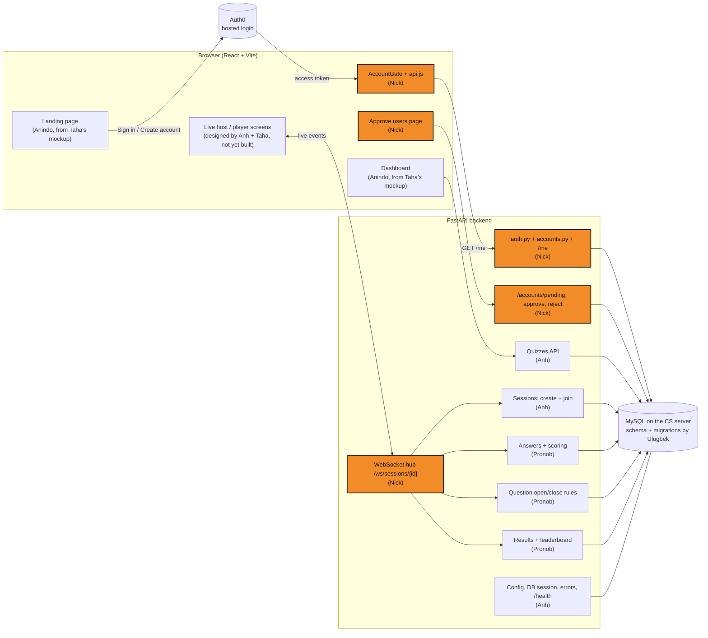
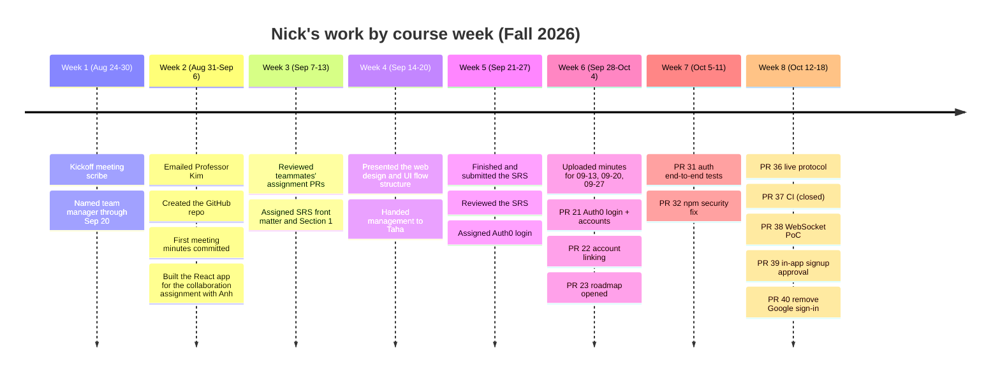

# Nick Pinto — Contributions to the CS440 Quiz Platform

This folder documents what Nick Pinto (GitHub: `sudo-nickPinto` / `spinto16`) contributed to the CS440 Fall 2026 capstone, a Kahoot-style quiz platform for Professor Kim, up through **PR #40**. It also gives a plain-language, week-by-week account of everyone else's work so Nick's work can be read in context.

> **Assumption:** this documentation treats every PR up to #40 as merged, including the ones still open on 2026-10-12 (#36, #38, #39, #40). The one exception is **#37 (CI workflow)**, which Nick closed on purpose ("not adding CI/tests right now") and is described as closed. Dates are in Eastern time, so a PR GitHub stamps "Oct 13, 01:30 UTC" shows here as Oct 12.

## Files in this folder

| File | What it covers |
|---|---|
| [01-authentication-and-accounts.md](01-authentication-and-accounts.md) | Login with Auth0, accounts in MySQL, joining Google and email logins into one account, in-app approval of new signups, removing Google sign-in, and the auth tests (PRs #21, #22, #31, #39, #40) |
| [02-live-sessions.md](02-live-sessions.md) | The real-time "play a quiz together" layer: the live protocol and the WebSocket proof of concept (PRs #36, #38) |
| [03-planning-process-and-maintenance.md](03-planning-process-and-maintenance.md) | Team management in weeks 1–3, client outreach, the repo, meeting minutes, the SRS, the MVP roadmap, the dependency security fix, and the proposed CI (PRs #23, #32, #37) |
| [04-team-timeline-by-week.md](04-team-timeline-by-week.md) | Week-by-week, plain-language account of the whole team's contributions, from Week 1 to Week 8 |

All diagrams are [Mermaid](https://mermaid.js.org/) blocks, so they render directly on GitHub.

## Nick's contributions at a glance

| PR | Course week | What it did (in one line) | Size |
|---|---|---|---|
| — | Wk 1–5 | Team manager through Sep 20, client email, repo setup, meeting minutes, SRS front matter and Section 1 | — |
| [#21](https://github.com/sudo-nickPinto/CS440-Quiz-Platform/pull/21) | Wk 6 | Users can sign up, log in and log out, and the backend checks who they are on every request | +768 / −47 |
| [#22](https://github.com/sudo-nickPinto/CS440-Quiz-Platform/pull/22) | Wk 6 | Logging in with Google or with email/password on the same email lands in the same account | +168 / −43 |
| [#23](https://github.com/sudo-nickPinto/CS440-Quiz-Platform/pull/23) | Wk 6 → 8 | MVP roadmap: Gantt chart, critical path, owners and "done when" for each task | +193 |
| [#31](https://github.com/sudo-nickPinto/CS440-Quiz-Platform/pull/31) | Wk 7 | 11 end-to-end tests proving protected routes really reject bad logins | +113 |
| [#32](https://github.com/sudo-nickPinto/CS440-Quiz-Platform/pull/32) | Wk 7 → 8 | Fixed a high-severity npm security warning | +3 / −3 |
| [#36](https://github.com/sudo-nickPinto/CS440-Quiz-Platform/pull/36) | Wk 8 | The live session protocol: the rulebook the host and player screens and the server follow during a game | +213 |
| [#37](https://github.com/sudo-nickPinto/CS440-Quiz-Platform/pull/37) | Wk 8 | *(closed)* Proposed automatic test/build checks on every PR | +75 |
| [#38](https://github.com/sudo-nickPinto/CS440-Quiz-Platform/pull/38) | Wk 8 | WebSocket proof of concept: a host and players can play questions in real time | +786 / −2 |
| [#39](https://github.com/sudo-nickPinto/CS440-Quiz-Platform/pull/39) | Wk 8 | New email signups wait for approval inside the app, instead of needing a verification email | +516 / −37 |
| [#40](https://github.com/sudo-nickPinto/CS440-Quiz-Platform/pull/40) | Wk 8 | Removed Google sign-in after the group decided to drop it | +14 / −599 |

## Where Nick's work sits in the system

The shaded boxes are what Nick built. Everything else was built by teammates, and Nick's code connects to it.

## Nick's timeline

